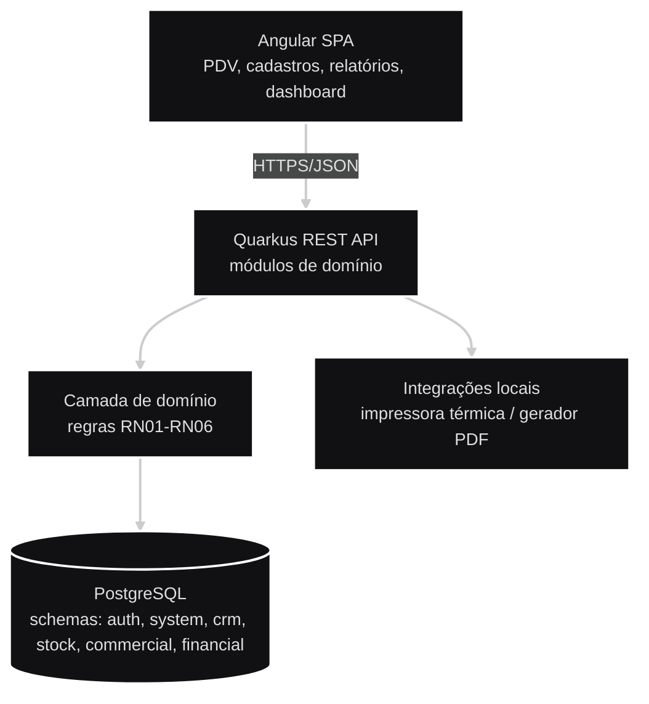

# Arquitetura

## 1. Visão geral

O RelSys é uma aplicação web em camadas, com frontend SPA Angular, backend Quarkus e banco PostgreSQL. A arquitetura é **monolítica modular**: os domínios `auth`, `system`, `crm`, `stock`, `commercial` e `financial` coexistem na mesma aplicação, mas com fronteiras explícitas de código e de schema.

## 2. Módulos e responsabilidades

| Módulo / schema | Responsabilidade | Diagramas de referência |
|---|---|---|
| `auth` | Usuários, papéis, permissões e associações | [[DER-auth]], [[classDiagram-auth]] |
| `system` | Empresa/filial, catálogo de mensagens, metadados | [[DER-system]], [[classDiagram-system]] |
| `crm` | Pessoa física/jurídica, cliente e fornecedor | [[DER-crm]], [[classDiagram-crm]] |
| `commercial` | Produto, relacionamento com fornecedor, lote de compra, venda e item | [[DER-commercial]], [[classDiagram-commercial]] |
| `stock` | Armazém, localização, tipo de movimento, movimentação e origem | [[DER-stock]], [[classDiagram-stock]] |
| `financial` | Formas de pagamento, contas, títulos, processo de caixa e movimentações | [[DER-financial]], [[classDiagram-financial]] |
| `shared` | Value objects e conversores (`CPF`, `CNPJ`, `Barcode`) | [[classDiagram-shared]] |

## 3. Fluxo típico de venda

1. Operador abre sessão de caixa (UC08) e o frontend consulta a sessão ativa.
2. Produtos são buscados por código de barras ou nome (UC09/UC05).
3. Descontos são validados conforme RN01 (UC11).
4. `POST /api/v1/sales` grava `SALE` + `PRODUCT_SALE`, baixa estoque por PEPS/FEFO e gera título financeiro.
5. UC10 formata e envia o comprovante à impressora térmica; 2ª via pode ser reemitida.
6. Fechamento consolida `CASH_PROCESS`, `CASH_PROCESS_ITEM` e `CASH_MOVEMENT` (UC08).

## 4. Decisões arquiteturais

| ID | Decisão | Justificativa |
|---|---|---|
| ADR-01 | Monólito modular, sem microsserviços na v1 | Reduz complexidade operacional; módulos já separados por domínio |
| ADR-02 | API REST JSON, contrato em [[ContratoAPI]] | Consumo direto pelo SPA Angular |
| ADR-03 | PostgreSQL com schemas por domínio | Isolamento lógico e integridade referencial entre domínios |
| ADR-04 | Multi-tenancy lógico por `COMPANY_ID` | Exigido por RNF05; vínculo usuário↔filial em `USERS_COMPANY` |
| ADR-05 | Histórico imutável por status, não por exclusão | RN04: cancelamento muda `SALE_STATUS` |
| ADR-06 | Geração de PDF e ZPL/PPLA no backend | RNF01/RNF02; padronização de layout térmico |
| ADR-07 | RBAC com menor privilégio | RN05 e RNF04; novo perfil começa sem permissões |

## 5. Qualidades arquiteturais

- **Segurança:** autenticação, RBAC, hash de senha e filtro por filial — detalhes em [[SegurancaPermissoes]].
- **Auditabilidade:** `CREATED_AT`/`UPDATED_AT` em todas as tabelas; histórico de vendas preservado.
- **Rastreabilidade:** matriz em [[Rastreabilidade]].
- **Privacidade:** dados pessoais e LGPD em [[Privacidade]].
- **Testabilidade:** camadas separadas permitem testes unitários de domínio e testes de API — [[QualidadeValidacao]].

## 6. Diagramas complementares

- [[DiagramaComponentes]] — componentes e dependências entre módulos.
- [[DiagramaImplantacao]] — ambientes, hospedagem e infraestrutura.
- [[DiagramaIntegracao]] — integrações externas e periféricos.
- [[DiagramaEstados]] — ciclos de vida de venda, título e sessão de caixa.

## 7. Pendências que impactam a arquitetura

Ver R-01, R-02, R-04, R-05, R-07, R-10 e R-14 em [[RiscosQuestoesAbertas]]. Essas decisões não foram aplicadas aos diagramas-base nesta branch.
