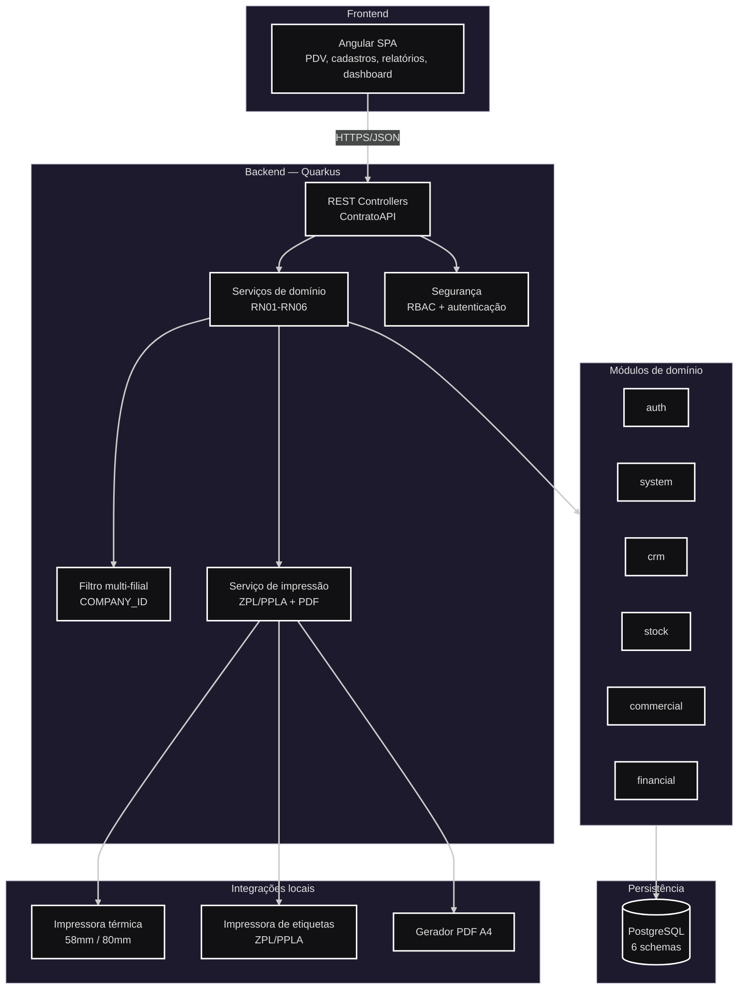

# Diagrama de Componentes

Item condicional atendido: há seis módulos de domínio e duas aplicações (SPA e API), conforme [[Arquitetura]].

## Responsabilidades dos componentes

| Componente | Responsabilidade | Referência |
|---|---|---|
| Angular SPA | Interface de PDV, cadastros, relatórios e dashboard | [[IndicePrototipos]] |
| REST Controllers | Exposição dos endpoints documentados | [[ContratoAPI]] |
| Serviços de domínio | Regras RN01–RN06 | [[Requisitos]] |
| Filtro multi-filial | Aplicação de `COMPANY_ID` nas consultas | [[SegurancaPermissoes]] |
| Segurança | Autenticação, RBAC e menor privilégio | [[SegurancaPermissoes]] |
| Serviço de impressão | Cupom térmico, etiquetas e PDF | [[DiagramaIntegracao]] |
| Módulos | Persistência por schema | DERs e class diagrams |
| PostgreSQL | Integridade referencial e transações | [[DER-system]] e demais DERs |

## Dependências relevantes

- `commercial` depende de `crm` (`CLIENT_ID`, `SUPPLIER_ID`), `financial` (`PAYMENT_METHOD_ID`) e `stock` (`PRODUCT_BATCH`).
- `stock` depende de `commercial` (`PRODUCT_ID`, `PRODUCT_BATCH_ID`) e de `financial` indiretamente via origem de movimento de venda.
- `financial` depende de `crm` (`PERSON_ID`), `commercial` (`SALE_ID`) e `system` (`COMPANY_ID`).
- `auth` e `system` são transversais a todos os módulos.

## Pendências

Ver R-02, R-04, R-05 e R-14 em [[RiscosQuestoesAbertas]]: componentes de sessão de caixa, catálogos por filial e autenticação ainda precisam de decisão de modelagem.
