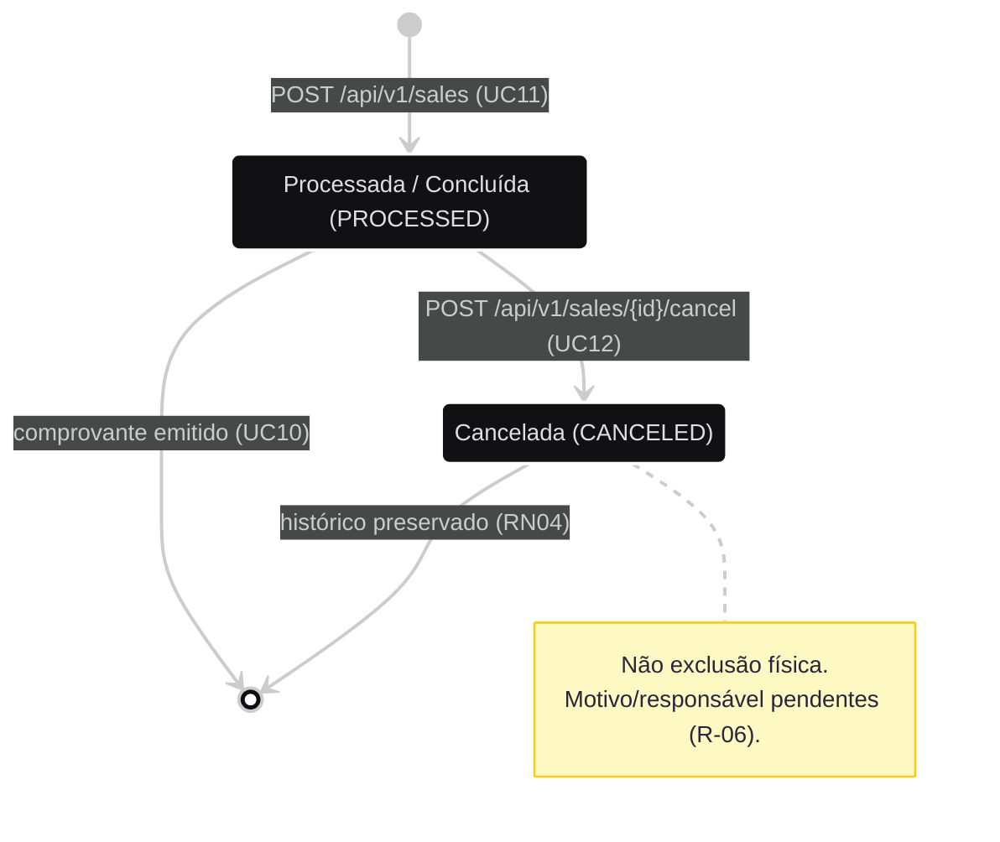
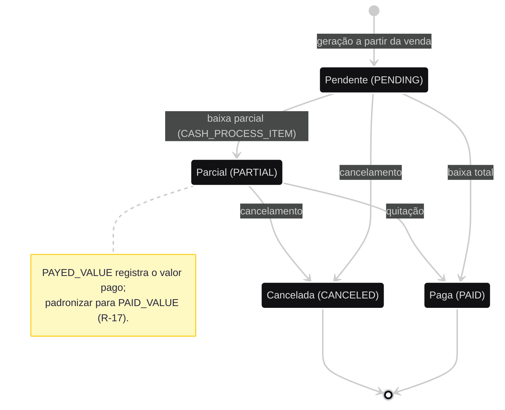
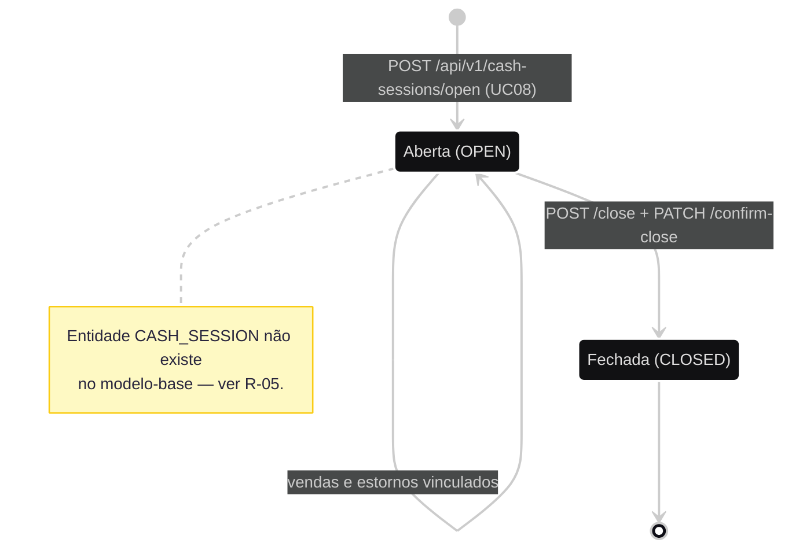

# Diagrama de Estados

Este documento cobre o item condicional “diagrama de estados, quando uma entidade possuir ciclo de vida”. Os estados de `SALE` e `FINANCIAL_TITLE` foram extraídos dos catálogos dos DERs; o ciclo de `CASH_SESSION` é **proposto**, pois a entidade ainda não existe no modelo-base (R-05 em [[RiscosQuestoesAbertas]]).

## 1. Venda — `SALE`

 Catálogo: `SALE_STATUS` = `PROCESSED`, `CANCELED` (`DER-commercial.md`).

## 2. Título financeiro — `FINANCIAL_TITLE`

Catálogo: `FINANCIAL_TITLE_STATUS` = `PENDING`, `PARTIAL`, `PAID`, `CANCELED` (`DER-financial.md`).

## 3. Sessão de caixa — proposta

## 4. Matriz de transições

| Entidade | Estado inicial | Transições | Estado final | Origem |
|---|---|---|---|---|
| `SALE` | `PROCESSED` | cancelar | `CANCELED` | UC12, RN04 |
| `FINANCIAL_TITLE` | `PENDING` | baixa parcial/total, cancelamento | `PAID` / `CANCELED` | DER-financial, UC11 |
| `CASH_SESSION` (proposta) | `OPEN` | sangria, reforço, venda, estorno, fechamento | `CLOSED` | UC08, RF16, RN06 |

>Este diagrama não altera os `erDiagram` existentes. A inclusão de `CASH_SESSION` depende de decisão formal registrada em [[RiscosQuestoesAbertas]].
