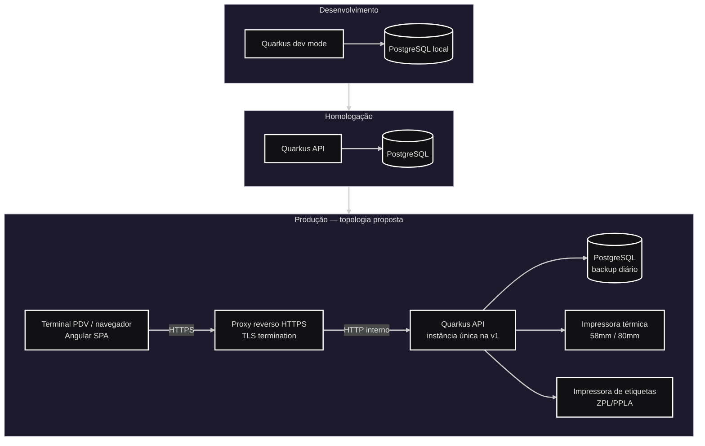

# Diagrama de Implantação

Item condicional atendido: a stack (Angular, Quarkus, PostgreSQL) e serviços de impressão são relevantes para a operação do PDV.

## Ambientes

| Ambiente | Finalidade | Dados | Observação |
|---|---|---|---|
| Desenvolvimento | Codificação e testes unitários | Massa fictícia | `Quarkus dev mode` + PostgreSQL local |
| Homologação | Validação UAT e testes de API | Massa anonimizada | Deve reproduzir configuração de produção |
| Produção | Operação das filiais | Dados reais | Exige backup, monitoramento e TLS |

## Componentes de infraestrutura

| Componente | Função | Referência |
|---|---|---|
| Proxy reverso | Terminação TLS e exposição HTTPS | RNF03 |
| Quarkus API | Processamento das regras e endpoints | [[ContratoAPI]] |
| PostgreSQL | Persistência dos seis schemas | DERs |
| Impressora térmica | Cupom não fiscal 58/80 mm | RNF01, UC10 |
| Impressora de etiquetas | ZPL/PPLA e PDF A4 | RNF02, UC06 |

## Considerações operacionais

1. **TLS obrigatório** entre terminal e proxy, conforme RNF03.
2. **Backup diário** do PostgreSQL e teste de restore periódico.
3. **Impressoras locais** conectadas ao terminal/PDV; a API apenas gera o conteúdo (ver [[DiagramaIntegracao]]).
4. **Escalabilidade:** v1 prevê uma instância da API; escalabilidade horizontal deve ser reavaliada se o número de filiais crescer.
5. **Monitoramento:** pendente de definição (logs de erro, latência de API, falhas de impressão).

> Hosting/cloud provider, domínio e IPs não foram definidos até esta versão; a topologia acima é a proposta arquitetural para a banca.
