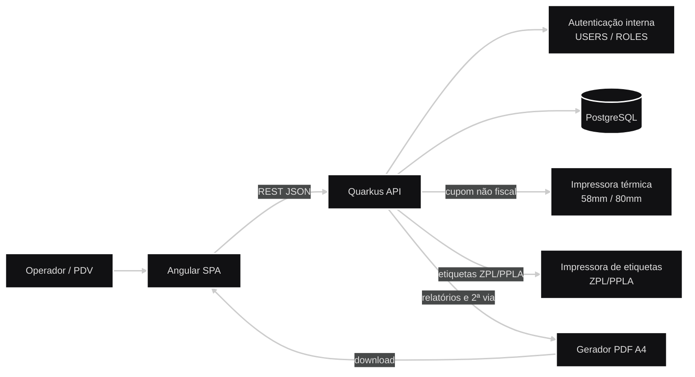

# Diagrama de Integração

Item condicional atendido: existem APIs internas, impressão térmica e geração de documentos, conforme RF08, RF15, RNF01 e RNF02.

## Integrações detalhadas

| Integração | Entrada | Saída | Caso de uso | Referência |
|---|---|---|---|---|
| PDV ↔ API | Busca de produto, venda, desconto, pagamento | Dados de produto, venda gravada | UC09, UC11 | [[ContratoAPI]] |
| API ↔ PostgreSQL | Comandos transacionais | Persistência de `SALE`, estoque e títulos | UC07, UC11, UC12 | DERs |
| API ↔ Autenticação | Credenciais e permissões | Sessão autorizada e filial ativa | UC14, UC16 | [[SegurancaPermissoes]] |
| API ↔ Impressora térmica | Layout de cupom 58/80 mm | Cupom impresso | UC10 | RNF01 |
| API ↔ Impressora de etiquetas | Código de barras e quantidade | Etiqueta ZPL/PPLA | UC06 | RNF02 |
| API ↔ Gerador PDF | Dados de relatório/2ª via | Arquivo PDF A4 | UC06, UC13 | RNF02, RF20 |

## Contratos de integração

- **REST/JSON:** padronizado em [[ContratoAPI]], com autenticação e filtro por filial.
- **Impressão térmica:** comandos ZPL/PPLA para etiquetas; cupom em largura de 58 mm ou 80 mm.
- **PDF:** gerado no backend e devido ao frontend como binário/download.

## Fora do escopo de integração

- Adquirentes de cartão, PIX e autorização externa de pagamento.
- SEFAZ/NF-e (cupom é não fiscal).
- APIs de clientes/fornecedores externos.
- Webhooks ou mensageria assíncrona.

## Pendências

- R-14: sessão autenticada sem modelo formal.
- R-20: reimpressão de 2ª via sem metadados de auditoria.
- Definir protocolo de conexão com impressoras (USB/rede) no ambiente de produção — ver [[DiagramaImplantacao]].
