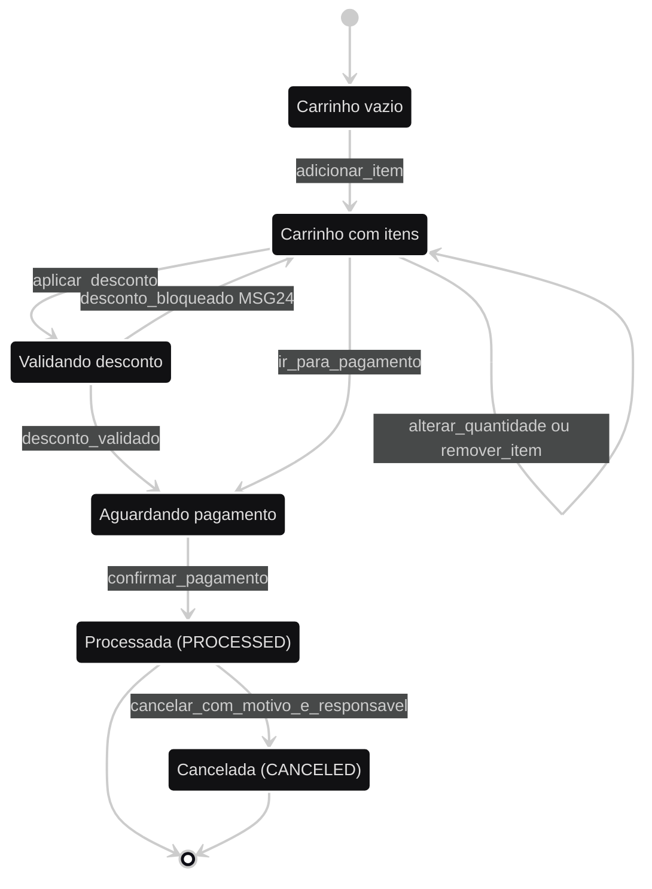
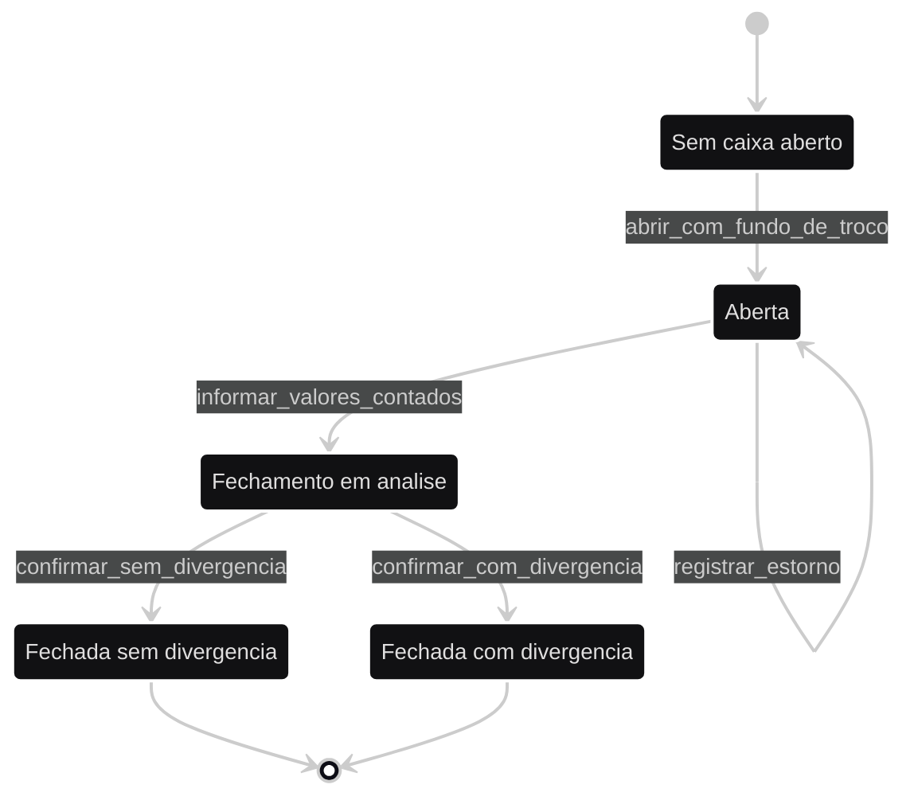
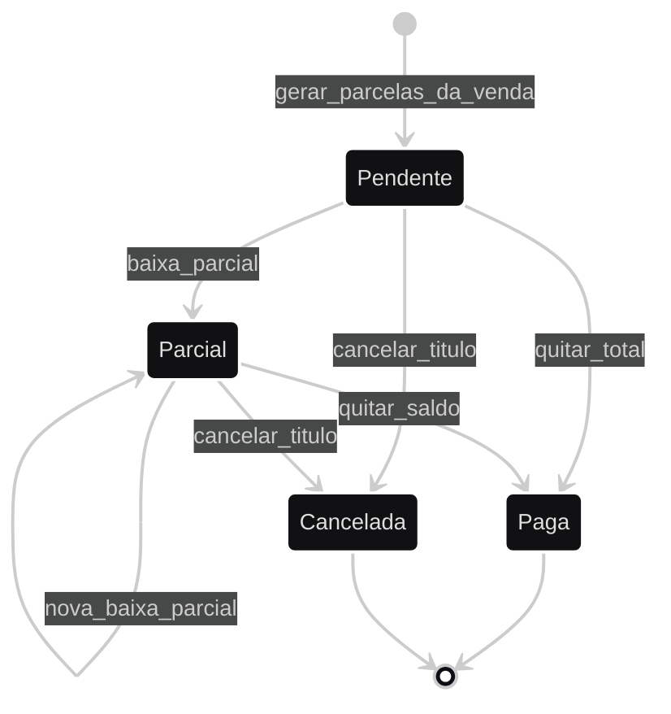
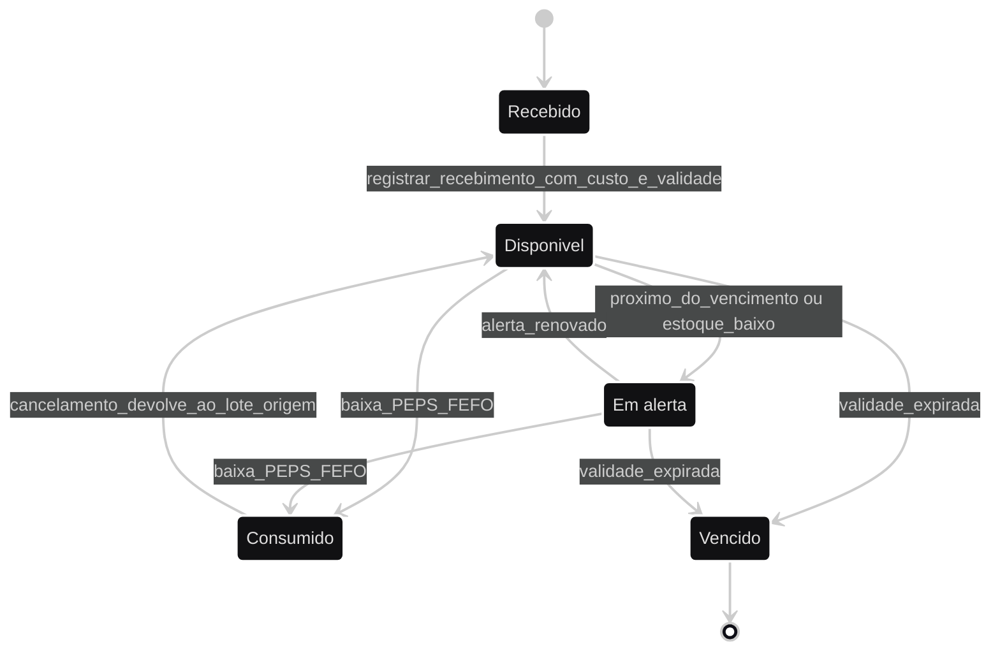
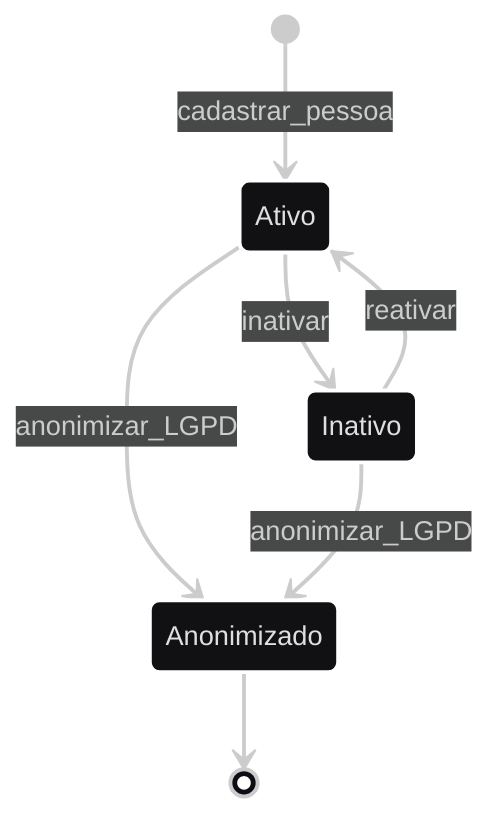
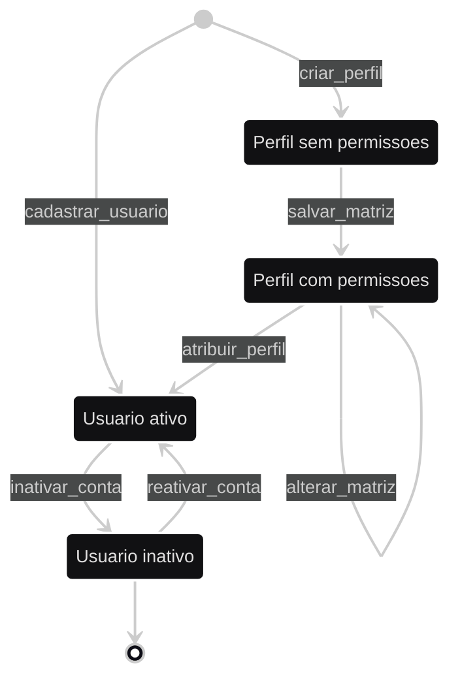
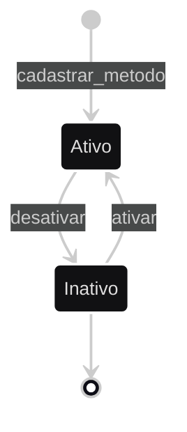

# Diagramas de estado do RelSys

Os estados abaixo complementam os diagramas de classe e os DER. Eles descrevem formalmente transições que hoje existem apenas em regras de negócio e casos de uso.

Legenda: **persistido** significa que o estado possui coluna/catálogo equivalente; **derivado** significa que é calculado a partir de dados persistidos; **proposto** significa que ainda não existe no DER e depende de decisão de modelagem.

## 1. Venda

| Estado | Origem | Observação |
|---|---|---|
| Carrinho vazio / com itens | UC09 (`UC09-RealizarVenda.md:8-17`) | Estado de UI, não persistido |
| Validando desconto | UC11 (`UC11-RegistrarPagamentoFinalizarVenda.md:48-59`) | RN01; bloqueio com MSG24 |
| Processada | `SALE_STATUS = PROCESSED` (`DER-commercial.md:80`) | Gravação imutável do histórico (RN04) |
| Cancelada | `SALE_STATUS = CANCELED` (`DER-commercial.md:80`) | Exige motivo, responsável, devolução de lote e estorno (UC12) |

## 2. Sessão de caixa

| Estado | Origem | Observação |
|---|---|---|
| Sem caixa aberto / Aberta / Fechada | UC08 (`UC08-GerenciarSessaoCaixa.md:6-21`) | **Proposto**: hoje não há entidade `CASH_SESSION` no DER |
| Fechamento em análise | UC08 (`UC08-GerenciarSessaoCaixa.md:64-72`) | Cálculo de divergências por operação (RN06) |
| Fechada com divergência | MSG21 (`UC08-GerenciarSessaoCaixa.md:32`) | Divergência é registrada, não bloqueia o fechamento |

> Não foi modelada reabertura de caixa. Reabrir uma sessão fechada exigiria regra formal de auditoria e permissão específica.

## 3. Título financeiro

| Estado | Origem | Observação |
|---|---|---|
| Pendente, Parcial, Paga, Cancelada | `FINANCIAL_TITLE_STATUS` (`DER-financial.md:41-46,123`) | **Persistido** |
| Geração de parcelas | `FinancialTitleOrigin` + `FinancialTitleBatch` (`DER-financial.md:55-78`) | Liga a venda ao lote de títulos |

> Um título já pago não retorna a “Pendente”. O estorno de uma venda deve gerar novo lançamento negativo/réplica de origem, preservando o histórico (RN04).

## 4. Lote de estoque

| Estado | Origem | Observação |
|---|---|---|
| Recebido | `PRODUCT_BATCH` (`DER-commercial.md:31-39`) | **Persistido** via recebimento (UC07) |
| Disponível / Consumido | `STOCK_MOVEMENT` (`DER-stock.md:48-61`) | **Derivado** do saldo do lote |
| Em alerta | Dashboard (`UC14-VisualizarDashboardGerencial.md:9,37`) | **Derivado**; não há campo de estado no DER |
| Vencido | `EXPIRATION_DATE` (`DER-commercial.md:36`) | **Derivado**; bloqueio de baixa ainda não especificado |

## 5. Cliente / pessoa

| Estado | Origem | Observação |
|---|---|---|
| Ativo / Inativo | `PERSON_STATUS` (`DER-crm.md:41-46,74`) | **Persistido** |
| Anonimizado | `Escopo.md:5`, `Requisitos.md:14,86` | **Proposto**: irreversível; vendas antigas permanecem com snapshot em `PRODUCT_SALE` e `SALE` |

## 6. Perfil e usuário

| Estado | Origem | Observação |
|---|---|---|
| Sem permissões → com permissões | UC15 (`UC15-Gerenciar Perfis e Permissões.md:14-16,25`) | Implementa RN05 |
| Usuário ativo/inativo | `USERS.ACTIVE` (`DER-auth.md:40-48`); UC16 (`:18,27`) | Inativação bloqueia novos logins; sessões ativas devem ser revogadas |

## 7. Método de pagamento

| Estado | Origem | Observação |
|---|---|---|
| Ativo / Inativo | UC01 (`UC01-ParametrizarMetodosPagamento.md:16,23`) | **Proposto**: `PAYMENT_METHOD` não possui coluna `ACTIVE` no DER (`DER-financial.md:22-30`) |

## 8. Matriz de rastreabilidade

| Artefato                           | Estados                                             | Regra/caso de uso relacionado |
| ---------------------------------- | --------------------------------------------------- | ----------------------------- |
| `SALE_STATUS`                      | Processada, Cancelada                               | RN04, UC11, UC12              |
| `CASH_SESSION`                     | Sem caixa, Aberta, Fechamento, Fechada              | RF16, RN06, UC08              |
| `FINANCIAL_TITLE_STATUS`           | Pendente, Parcial, Paga, Cancelada                  | `DER-financial.md:123`        |
| `PRODUCT_BATCH` + `STOCK_MOVEMENT` | Recebido, Disponível, Em alerta, Consumido, Vencido | RN02, UC07, UC11, UC12, UC14  |
| `PERSON_STATUS`                    | Ativo, Inativo, Anonimizado                         | RF02, RNF03                   |
| `ROLES_PERMISSIONS` / `USERS`      | Perfil sem/com permissões, usuário ativo/inativo    | RN05, UC15, UC16              |
| `PAYMENT_METHOD`                   | Ativo, Inativo                                      | RF04, UC01                    |
