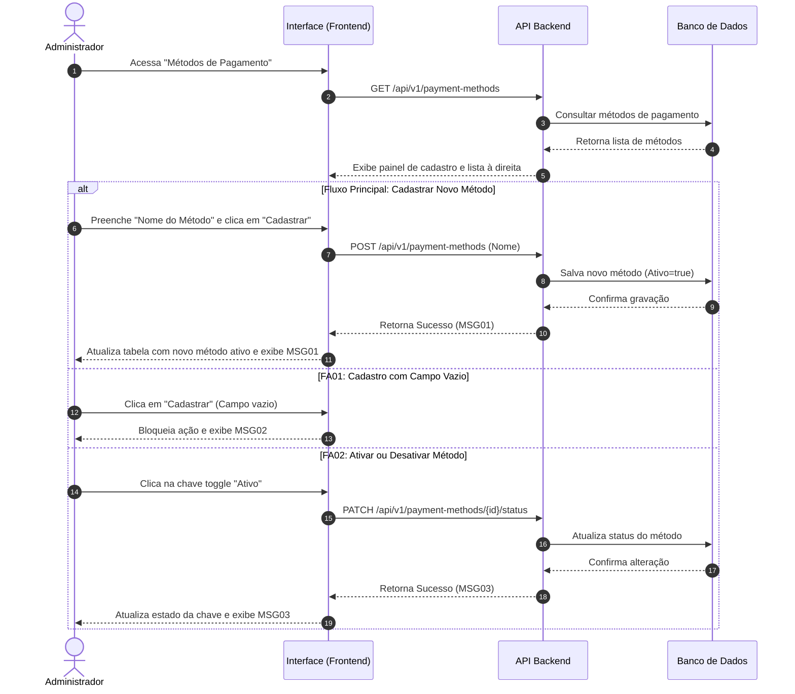

UC01 - Parametrizar Métodos de Pagamento Objetivo: Cadastrar e gerenciar as formas de pagamento aceitas. Requisitos Relacionados: [RF04] 

Fluxo Principal (Cadastrar Novo Método):

1. O administrador acessa o menu lateral e clica em "Métodos de Pagamento" [RF04].
    
2. O sistema exibe o painel de cadastro à esquerda e a lista de métodos já cadastrados à direita.
    
3. O administrador preenche o campo de texto "Nome do Método" (ex: "Cartão de Crédito - Visa/Master").
    
4. O administrador clica no botão azul "Cadastrar".
    
5. O sistema grava o dado no banco e exibe a mensagem (MSG01).
    
6. O sistema atualiza a tabela à direita, exibindo o novo método com uma chave (toggle switch) na coluna "Ativo" marcada como ligada por padrão.
    

Fluxos Alternativos:

- FA01 - Cadastro com Campo Vazio: No passo 4, o administrador clica em "Cadastrar" deixando o campo vazio. O sistema bloqueia a ação e exibe a mensagem (MSG02).
    
- FA02 - Ativar ou Desativar Método: O administrador clica na chave "Ativo" para desligar um método. O sistema atualiza o status no banco e exibe a mensagem (MSG03). Ao realizar o fluxo do PDV [RF14], este método inativado não aparecerá para o operador.
    

Mensagens do Sistema (UC01):

- MSG01: "Método de pagamento cadastrado com sucesso!"
    
- MSG02: "Informe o nome do método de pagamento."
    
- MSG03: "Status do método de pagamento atualizado."
    

