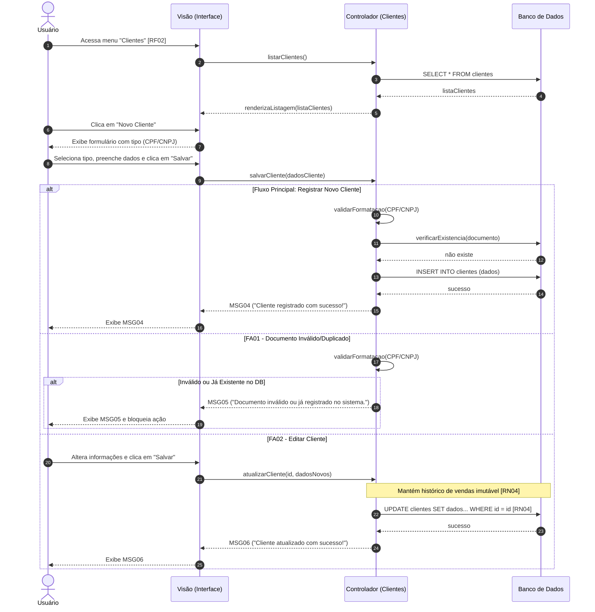

Objetivo: Criar e manter a base de clientes do estabelecimento. Requisitos Relacionados: [RF02], [RN04]

Fluxo Principal (Registrar Novo Cliente):

1. O usuário acessa o menu lateral e clica em "Clientes" [RF02].
    
2. O sistema apresenta a listagem e o usuário clica em "Novo Cliente".
    
3. O sistema exibe um formulário e solicita a seleção do tipo: "Pessoa Física (CPF)" ou "Pessoa Jurídica (CNPJ)".
    
4. O usuário seleciona o tipo e preenche os dados obrigatórios.
    
5. O usuário clica em "Salvar".
    
6. O sistema valida a formatação do documento (CPF/CNPJ), grava os dados e exibe a mensagem (MSG04).
    

Fluxos Alternativos:

- FA01 - Documento Inválido/Duplicado: No passo 6, se o CPF/CNPJ for inválido ou já existir na base, o sistema bloqueia e exibe a mensagem (MSG05).
    
- FA02 - Editar Cliente: O usuário altera informações e salva. O sistema atualiza o registro, mantendo o histórico de vendas antigas intacto, garantindo a imutabilidade [RN04]. O sistema exibe a mensagem (MSG06).
    

Mensagens do Sistema (UC02):

- MSG04: "Cliente registrado com sucesso!"
    
- MSG05: "Documento inválido ou já registrado no sistema."
    
- MSG06: "Cliente atualizado com sucesso!"
    

