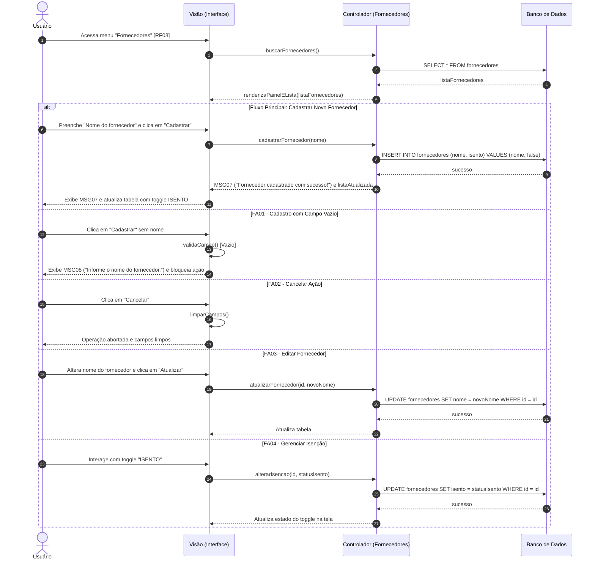

Objetivo: Cadastrar fornecedores e configurar regras fiscais/comerciais (isenção). Requisitos Relacionados: [RF03]

Fluxo Principal (Cadastrar Novo Fornecedor):

1. O usuário acessa o menu lateral e clica em "Fornecedores" [RF03].
    
2. O sistema exibe o painel "Novo Fornecedor" e a lista de "Fornecedores Cadastrados".
    
3. O usuário preenche o campo de texto "Nome do fornecedor" e clica em "Cadastrar".
    
4. O sistema valida os dados e exibe a mensagem (MSG07).
    
5. O sistema atualiza a tabela, exibindo o novo fornecedor com a chave (toggle switch) na coluna ISENTO.
    

Fluxos Alternativos:

- FA01 - Cadastro com Campo Vazio: O usuário clica em "Cadastrar" sem preencher o nome. O sistema bloqueia a ação e exibe a mensagem (MSG08).
    
- FA02 - Cancelar Ação: O usuário clica em "Cancelar". O sistema aborta a operação e limpa os campos.
    
- FA03 - Editar Fornecedor: O usuário aciona a edição, altera o nome e clica em "Atualizar".
    
- FA04 - Gerenciar Isenção: O usuário interage com o toggle "ISENTO" para marcar/desmarcar a isenção de descontos para produtos deste fornecedor.
    

Mensagens do Sistema (UC03):

- MSG07: "Fornecedor cadastrado com sucesso!"
    
- MSG08: "Informe o nome do fornecedor."
    

