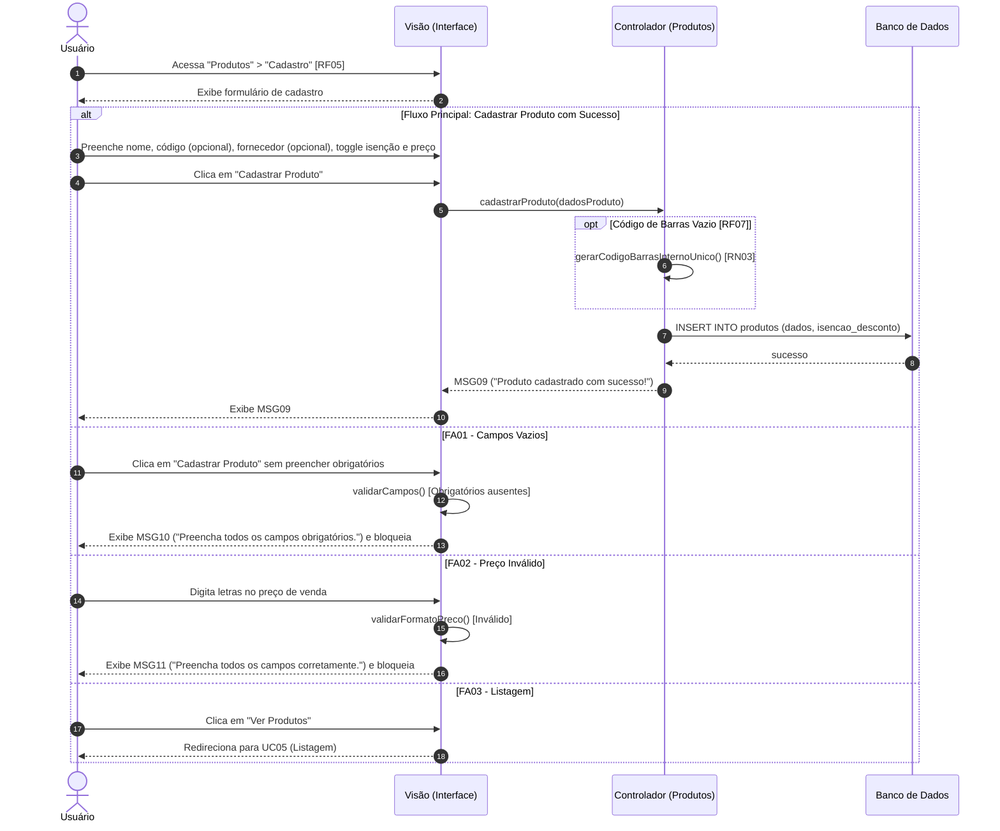

Objetivo: Cadastrar produtos no estoque com regras de código e precificação. Requisitos Relacionados: [RF05, RF07], [RN01, RN03]

Fluxo Principal (Cadastrar Produto com Sucesso):

1. O usuário acessa "Produtos" > "Cadastro" [RF05].
    
2. O usuário preenche o "Nome do produto".
    
3. O usuário digita o "Código de barras" (ou deixa em branco).
    
4. O usuário seleciona um "Fornecedor" (opcional).
    
5. O usuário interage com a chave "Isenção de Desconto" para ativar/desativar a restrição [RN01].
    
6. O usuário preenche o "R$ Preço de venda" com números e clica em "Cadastrar Produto".
    
7. O sistema gera automaticamente um código de barras interno único [RN03] caso o campo correspondente tenha sido deixado em branco [RF07].
    
8. O sistema grava o produto e exibe a mensagem (MSG09).
    

Fluxos Alternativos:

- FA01 - Campos Vazios: Faltam dados obrigatórios. O sistema bloqueia e exibe a mensagem (MSG10).
    
- FA02 - Preço Inválido: O usuário digita letras no preço. O sistema bloqueia e exibe a mensagem (MSG11).
    
- FA03 - Listagem: O usuário clica em "Ver Produtos", abandonando o cadastro.
    

Mensagens do Sistema (UC04):

- MSG09: "Produto cadastrado com sucesso!"
    
- MSG10: "Preencha todos os campos obrigatórios."
    
- MSG11: "Preencha todos os campos corretamente."
    

