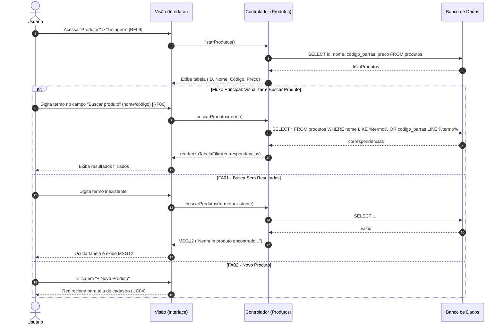

Objetivo: Buscar e visualizar itens do inventário. Requisitos Relacionados: [RF06, RF09]

Fluxo Principal (Visualizar e Buscar Produto):

1. O usuário acessa "Produtos" > "Listagem" para consultar a posição atual [RF09].
    
2. A tabela exibe ID, Nome, Código de Barras e Preço.
    
3. O usuário digita no campo "Buscar produto" (nome ou código de barras) [RF06].
    
4. O sistema filtra automaticamente e exibe as correspondências.
    

Fluxos Alternativos:

- FA01 - Busca Sem Resultados: O termo não existe no banco. O sistema oculta a tabela e exibe a mensagem (MSG12).
    
- FA02 - Novo Produto: O usuário clica em "+ Novo Produto" e é redirecionado ao UC04.
    

Mensagens do Sistema (UC05):

- MSG12: "Nenhum produto encontrado. Tente alterar o termo de busca."
    

