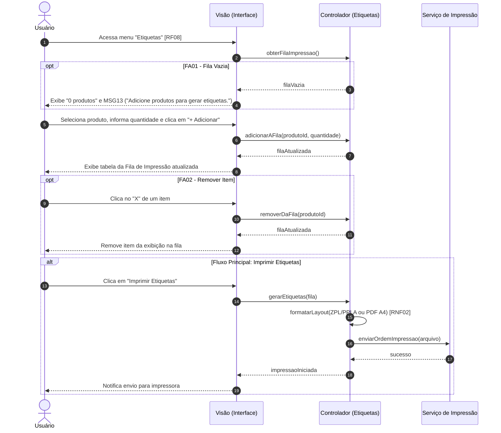

Objetivo: Criar identificação física (código de barras) para as mercadorias. Requisitos Relacionados: [RF08], [RNF02]

Fluxo Principal:

1. O usuário acessa o menu e clica em "Etiquetas" [RF08].
    
2. Seleciona o produto, informa a quantidade e clica em "+ Adicionar".
    
3. O sistema atualiza a "Fila de Impressão".
    
4. O usuário clica em "Imprimir Etiquetas".
    
5. O sistema gera o arquivo compatível com impressoras térmicas (ZPL/PPLA) ou PDF (A4) [RNF02] e envia para impressão.
    

Fluxos Alternativos:

- FA01 - Fila Vazia: Ao acessar, a fila exibe "0 produtos" e a mensagem (MSG13).
    
- FA02 - Remover Item: O usuário clica no "X" e o item sai da fila.
    

Mensagens do Sistema (UC06):

- MSG13: "Adicione produtos para gerar etiquetas."
    

