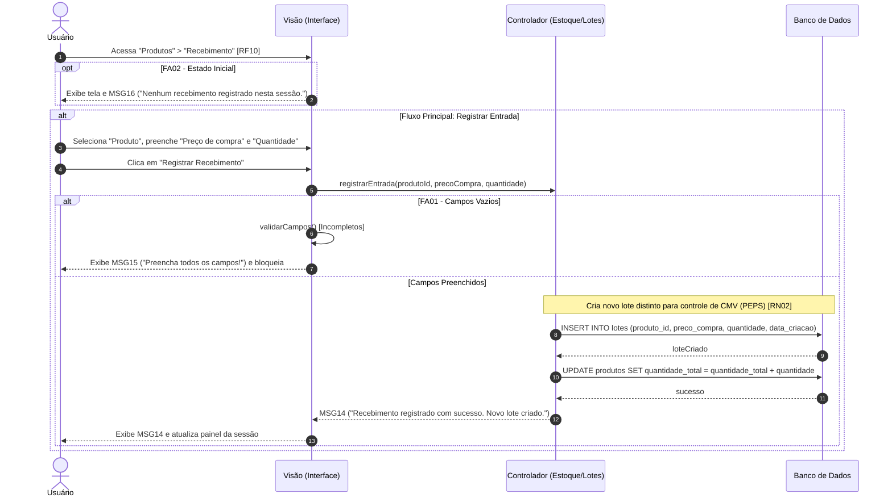

Objetivo: Dar entrada em mercadorias e definir preço de custo. Requisitos Relacionados: [RF10, RF11], [RN02]

Fluxo Principal:

1. O usuário acessa "Produtos" > "Recebimento" [RF10].
    
2. Seleciona o "Produto", informa o "R$ Preço de compra (unitário)" [RF11] e a "Quantidade".
    
3. O usuário clica em "Registrar Recebimento".
    
4. O sistema processa a entrada criando um novo lote distinto para suportar o cálculo de CMV [RN02].
    
5. O sistema atualiza o painel e exibe a mensagem (MSG14).
    

Fluxos Alternativos:

- FA01 - Campos Vazios: O sistema bloqueia a gravação e exibe a mensagem (MSG15).
    
- FA02 - Estado Inicial: Sem registros na sessão, exibe a mensagem (MSG16).
    

Mensagens do Sistema (UC07):

- MSG14: "Recebimento registrado com sucesso. Novo lote criado."
    
- MSG15: "Preencha todos os campos!"
    
- MSG16: "Nenhum recebimento registrado nesta sessão."
    

