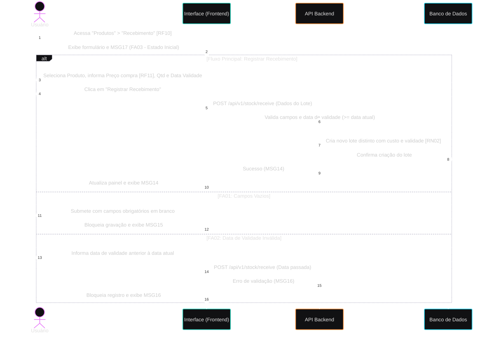

Objetivo: Dar entrada em mercadorias definindo preço de custo e data de validade do lote. Requisitos Relacionados: [RF10, RF11], [RN02] 

Fluxo Principal:

1. O usuário acessa "Produtos" > "Recebimento" [RF10].
    
2. Seleciona o "Produto", informa o "R$ Preço de compra (unitário)" [RF11], a "Quantidade" e a "Data de Validade" do lote (opcional para itens não perecíveis).
    
3. O usuário clica em "Registrar Recebimento".
    
4. O sistema processa a entrada criando um novo lote distinto com seu custo unitário e validade para suportar o cálculo de CMV e alertas de vencimento [RN02].
    
5. O sistema atualiza o painel e exibe a mensagem (MSG14).
    

Fluxos Alternativos:

- FA01 - Campos Vazios: O usuário deixa campos obrigatórios em branco. O sistema bloqueia a gravação e exibe a mensagem (MSG15).
    
- FA02 - Data de Validade Inválida: O usuário informa uma data de validade anterior à data atual. O sistema bloqueia o registro e exibe a mensagem (MSG16).
    
- FA03 - Estado Inicial: Sem registros na sessão, exibe a mensagem (MSG17).
    

Mensagens do Sistema (UC07):

- MSG14: "Recebimento registrado com sucesso. Novo lote criado."
    
- MSG15: "Preencha todos os campos obrigatórios!"
    
- MSG16: "A data de validade não pode ser anterior à data atual."
    
- MSG17: "Nenhum recebimento registrado nesta sessão."
    

**
