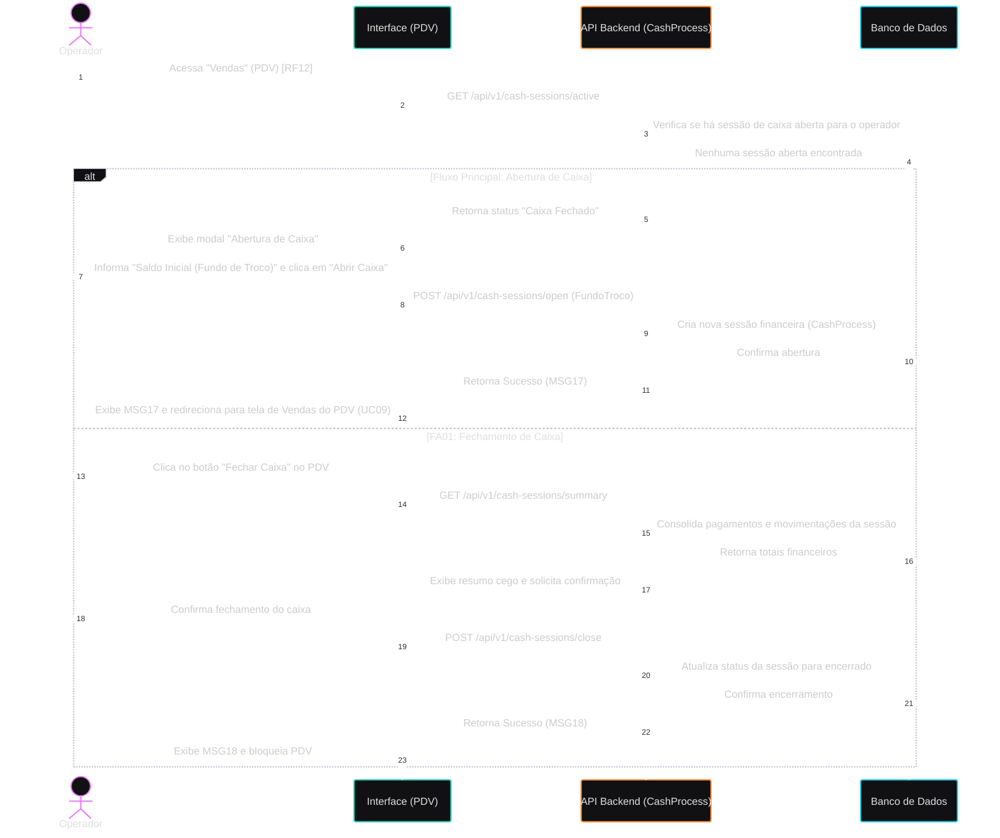

UC08 - Gerenciar Sessão de Caixa Objetivo: Controlar abertura, reforço, sangria e fechamento do caixa operacional. Requisitos Relacionados: [RF12] Fluxo Principal (Abertura de Caixa):

1. O Usuário acessa o menu lateral e clica em "Vendas" (PDV) [RF12].
    
2. O sistema detecta que não há um caixa aberto para o usuário e exibe o modal de "Abertura de Caixa".
    
3. O Usuário informa o "Saldo Inicial (Fundo de Troco)" e clica em "Abrir Caixa".
    
4. O sistema registra a sessão no módulo financeiro (CashProcess) e exibe a mensagem (MSG17).
    
5. O sistema redireciona o usuário para a interface de vendas do PDV (UC09).
    

Fluxos Alternativos:

- FA01 - Fechamento de Caixa: O usuário clica no botão "Fechar Caixa" no PDV. O sistema consolida todos os pagamentos e movimentações, exibe o resumo cego, solicita a confirmação e encerra a sessão, exibindo a mensagem (MSG18).
    
Mensagens do Sistema (UC08): 

- MSG17: "Caixa aberto com sucesso. Boas vendas!" 

- MSG18: "Sessão de caixa encerrada."

