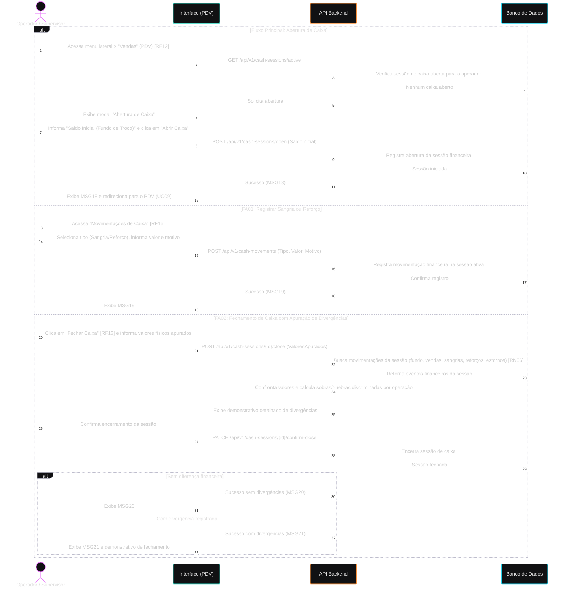

Objetivo: Controlar abertura, reforço, sangria e fechamento do caixa operacional com apuração detalhada de divergências por operação. Requisitos Relacionados: [RF12, RF16], [RN06] 

Fluxo Principal (Abertura de Caixa):

1. O operador acessa o menu lateral e clica em "Vendas" (PDV) [RF12].
    
2. O sistema detecta que não há um caixa aberto para o usuário e exibe o modal de "Abertura de Caixa".
    
3. O operador informa o "Saldo Inicial (Fundo de Troco)" e clica em "Abrir Caixa".
    
4. O sistema registra a abertura da sessão de caixa no módulo financeiro e exibe a mensagem (MSG18).
    
5. O sistema redireciona o operador para a interface de vendas do PDV (UC09).
    

Fluxos Alternativos:

- FA01 - Registrar Sangria ou Reforço: Com o caixa aberto, o operador (ou supervisor autorizado) acessa "Movimentações de Caixa" [RF16], seleciona o tipo ("Sangria" para retirada ou "Reforço" para suprimento), informa o valor e o motivo. O sistema registra a movimentação financeira na sessão ativa e exibe a mensagem (MSG19).
    
- FA02 - Fechamento de Caixa com Explicação de Divergências: O operador clica no botão "Fechar Caixa" no PDV [RF16] e informa os valores físicos apurados por método de pagamento. O sistema confronta os valores informados contra todas as movimentações registradas na sessão (fundo de troco, vendas por método de pagamento, sangrias, reforços e estornos/cancelamentos) [RN06]. O sistema exibe o demonstrativo detalhado apontando eventuais sobras ou quebras discriminadas por operação, solicita confirmação e encerra a sessão, exibindo (MSG20) se não houver diferença ou (MSG21) caso haja divergência registrada.
    

Mensagens do Sistema (UC08):

- MSG18: "Caixa aberto com sucesso. Boas vendas!"
    
- MSG19: "Movimentação de caixa registrada com sucesso."
    
- MSG20: "Sessão de caixa encerrada sem divergências."
    
- MSG21: "Sessão de caixa encerrada com divergências discriminadas no relatório de fechamento."

