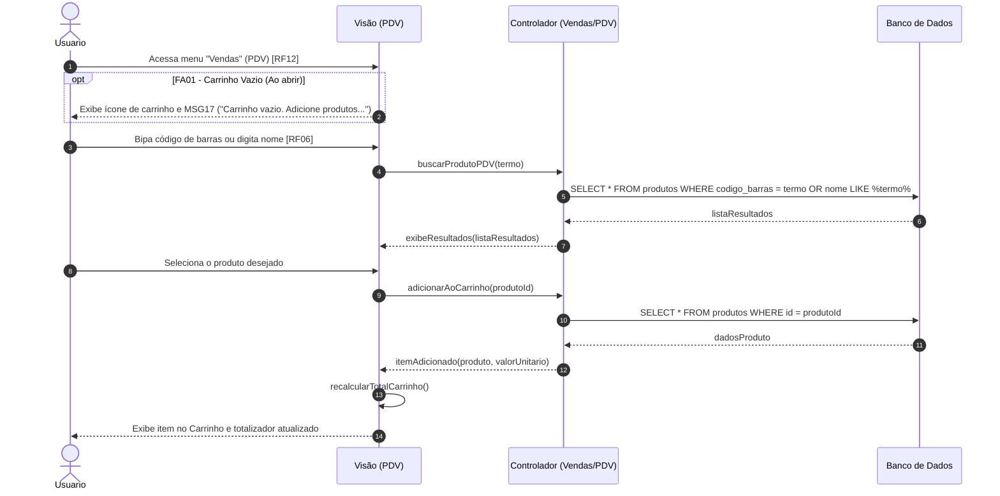

Objetivo: Iniciar o fluxo de caixa bipando produtos. Requisitos Relacionados: [RF06, RF12]

Fluxo Principal:

1. O usuário acessa "Vendas" (PDV) [RF12].
    
2. O usuário bipa o código de barras com o leitor ou digita o nome [RF06].
    
3. O sistema lista os resultados, o usuário seleciona.
    
4. O item vai para o "Carrinho" e totaliza os valores.
    

Fluxos Alternativos:

- FA01 - Carrinho Vazio: Ao abrir a tela, o sistema exibe o ícone de carrinho e a mensagem (MSG17).
    

Mensagens do Sistema (UC08):

- MSG17: "Carrinho vazio. Adicione produtos por código de barras ou nome."
    

