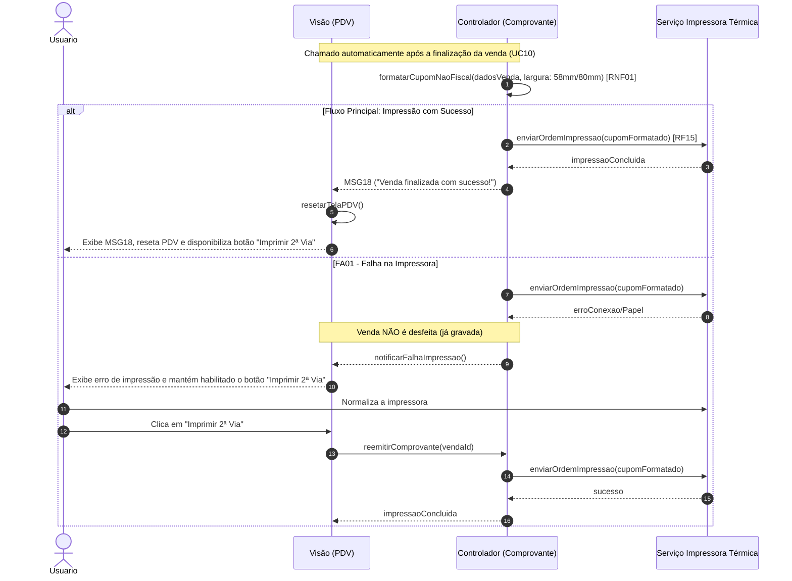

Objetivo: Entregar a via física ou digital ao cliente. Requisitos Relacionados: [RF15], [RNF01]

Fluxo Principal:

1. Após a finalização da venda (via UC10), o sistema formata o layout do cupom não fiscal para bobinas de 58mm ou 80mm [RNF01].
    
2. O sistema envia a ordem para a impressora térmica [RF15].
    
3. A tela do PDV é resetada, preparada para a próxima venda e exibe a mensagem (MSG18).
    
4. Um botão "Imprimir 2ª Via" fica disponível na interface.
    

Fluxos Alternativos:

- FA01 - Falha na Impressora: A venda não é desfeita (pois já foi gravada). O usuário permite que a impressora normalize e clica em "Imprimir 2ª Via".
    

Mensagens do Sistema (UC09):

- MSG18: "Venda finalizada com sucesso!"
    

