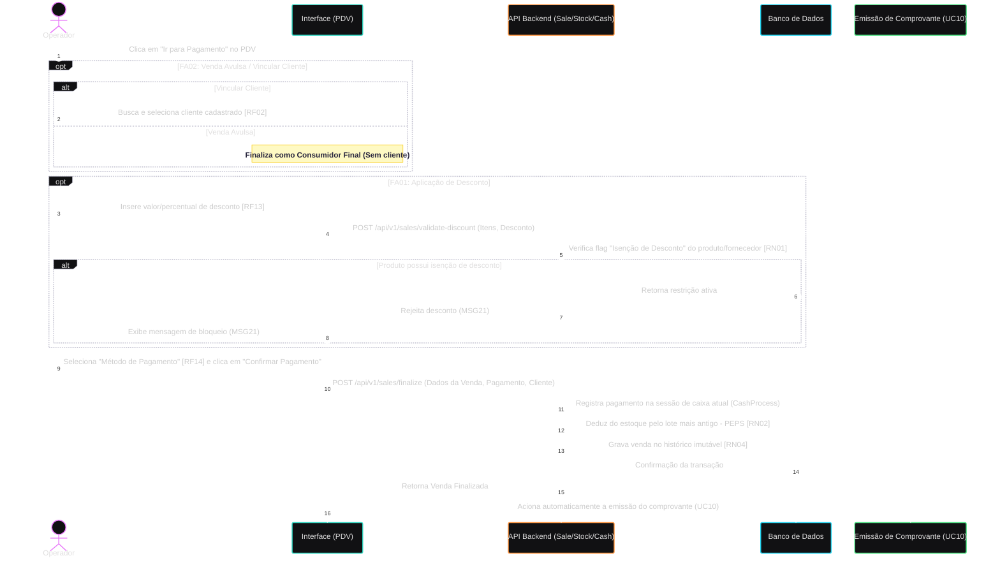

UC11 - Registrar Pagamento e Finalizar Venda Objetivo: Aplicar descontos, receber valores e baixar estoque. Requisitos Relacionados: [RF02, RF13, RF14], [RN01, RN02] Fluxo Principal:

1. O operador clica em "Ir para Pagamento" na tela do PDV.
    
2. O operador vincula um cliente cadastrado [RF02] (opcional).
    
3. O operador seleciona o Método de Pagamento [RF14].
    
4. O operador clica em "Confirmar Pagamento".
    
5. O sistema registra o pagamento na sessão de caixa atual (CashProcess).
    
6. O sistema deduz do estoque vinculando a venda ao lote mais antigo para cálculo de lucro (Controle PEPS) [RN02].
    
7. O sistema chama automaticamente a emissão de comprovante (UC10).
    

Fluxos Alternativos:

- FA01 - Aplicar Desconto: O operador insere desconto [RF13]. O sistema valida a flag "Isenção de Desconto" [RN01]. Se isento, bloqueia o abatimento naquele item restrito e exibe a mensagem (MSG21).
    
- FA02 - Venda Avulsa: O operador não vincula nenhum cliente e finaliza como consumidor final.
    

Mensagens do Sistema (UC11):

- MSG21: "Desconto Bloqueado: O(s) produto(s) selecionado(s) possui(em) isenção de desconto configurada para o fornecedor atual."
    

