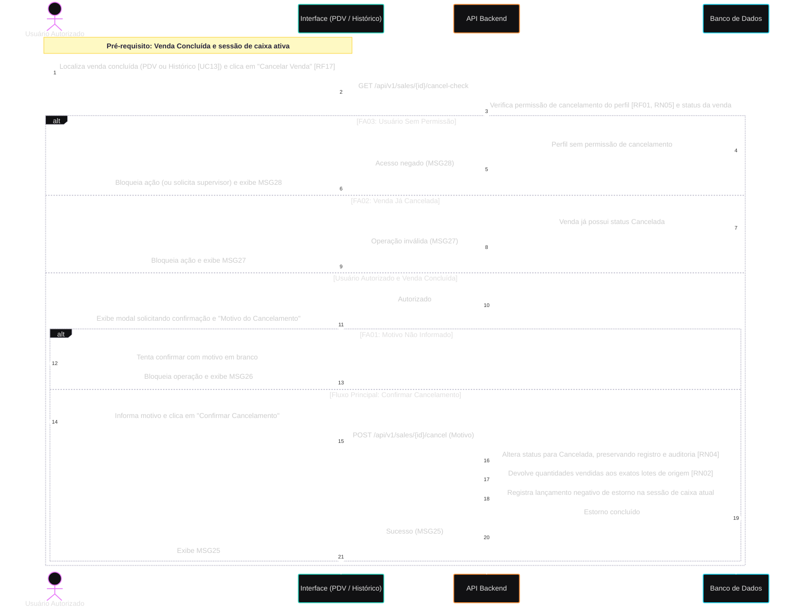

Objetivo: Cancelar uma venda concluída de forma auditável, devolvendo os produtos aos lotes originais e estornando o lançamento financeiro no caixa. 
Requisitos Relacionados: [RF01, RF17], [RN02, RN04, RN05] Pré-requisito: Venda existente com status Concluída e sessão de caixa ativa para registro do estorno financeiro. 

Fluxo Principal:

1. O usuário autorizado localiza a venda concluída (através de "Últimas Vendas" no PDV ou no "Histórico de Vendas" [UC13]) e clica em "Cancelar Venda" [RF17].
    
2. O sistema valida se o perfil do usuário possui a permissão de acesso para cancelamento [RF01, RN05].
    
3. O sistema exibe um modal solicitando a confirmação e o preenchimento obrigatório do "Motivo do Cancelamento".
    
4. O usuário informa o motivo e clica em "Confirmar Cancelamento".
    
5. O sistema altera o status da venda para Cancelada, preservando o registro original, data/hora, operador responsável e motivo no histórico imutável [RN04].
    
6. O sistema devolve automaticamente as quantidades vendidas aos exatos lotes de origem daquela venda [RN02].
    
7. O sistema registra um lançamento financeiro negativo de estorno vinculado à sessão de caixa atual e exibe a mensagem (MSG25).
    

Fluxos Alternativos:

- FA01 - Motivo Não Informado: No passo 4, o usuário tenta confirmar sem preencher o motivo. O sistema bloqueia a operação e exibe a mensagem (MSG26).
    
- FA02 - Venda Já Cancelada: O usuário tenta cancelar uma venda que já possui status Cancelada. O sistema bloqueia a ação e exibe a mensagem (MSG27).
    
- FA03 - Usuário Sem Permissão: Um operador sem permissão tenta cancelar uma venda [RN05]. O sistema bloqueia a ação (ou solicita autorização de supervisor) e exibe a mensagem (MSG28).
    

Mensagens do Sistema (UC12):

- MSG25: "Venda cancelada com sucesso. Estoque e caixa estornados."
    
- MSG26: "Informe o motivo do cancelamento da venda."
    
- MSG27: "Esta venda já se encontra cancelada."
    
- MSG28: "Acesso negado: você não possui permissão para cancelar vendas."

