Objetivo: Extrair histórico e conferir faturamento. Requisitos Relacionados: [RF17, RF18], [RN04]

Fluxo Principal:

1. O usuário acessa "Relatórios" > "Histórico de Vendas" [RF17].
    
2. Preenche os filtros (Data, Cliente, Método) e clica em "Aplicar Filtros".
    
3. O sistema busca os dados no histórico imutável [RN04] e lista na tabela.
    
4. O usuário clica em "Exportar PDF" [RF18].
    
5. O sistema compila o PDF, inicia o download e exibe a mensagem (MSG20).
    

Fluxos Alternativos:

- FA01 - Busca Sem Resultados: Com filtros vazios, o sistema oculta a tabela, desabilita a exportação e exibe a mensagem (MSG21).
    
- FA02 - Visualizar Detalhes: O usuário clica sobre a venda na tabela para ver os itens, descontos e emitir 2ª via.
    

Mensagens do Sistema (UC11):

- MSG20: "Relatório de vendas gerado e exportado em PDF com sucesso."
    
- MSG21: "Nenhuma venda encontrada para o período selecionado."

```mermaid-next
sequenceDiagram
    autonumber
    actor User as Usuário
    participant UI as Visão (Interface)
    participant Controller as Controlador (Relatórios)
    participant DB as Banco de Dados
    participant PDFGen as Gerador PDF

    User->>UI: Acessa "Relatórios" > "Histórico de Vendas" [RF17]
    User->>UI: Preenche filtros (Data, Cliente, Método) e clica em "Aplicar Filtros"
    UI->>Controller: buscarHistoricoVendas(filtros)

    Note over Controller,DB: Busca dados no histórico imutável [RN04]
    Controller->>DB: SELECT * FROM vendas_historico WHERE filtros [RN04]
    DB-->>Controller: resultadosVendas

    alt FA01 - Busca Sem Resultados
        Controller-->>UI: listaVazia
        UI->>UI: desabilitarExportacao()
        UI-->>User: Oculta tabela e exibe MSG21 ("Nenhuma venda encontrada...")

    else Fluxo Principal: Dados Encontrados e Exportação
        Controller-->>UI: resultadosVendas
        UI-->>User: Lista vendas na tabela

        opt FA02 - Visualizar Detalhes
            User->>UI: Clica sobre uma venda na tabela
            UI->>Controller: detalharVenda(vendaId)
            Controller->>DB: SELECT * FROM itens_venda WHERE venda_id = vendaId
            DB-->>Controller: detalhes
            Controller-->>UI: exibeModalDetalhes(detalhes, opcao2aVia)
        end

        User->>UI: Clica em "Exportar PDF" [RF18]
        UI->>Controller: exportarRelatorioPDF(resultadosVendas)
        Controller->>PDFGen: compilarPDF(dados)
        PDFGen-->>Controller: arquivoPDF
        Controller-->>UI: MSG20 ("Relatório de vendas gerado...") + downloadStream
        UI-->>User: Exibe MSG20 e inicia download do arquivo PDF
    end
```
    

