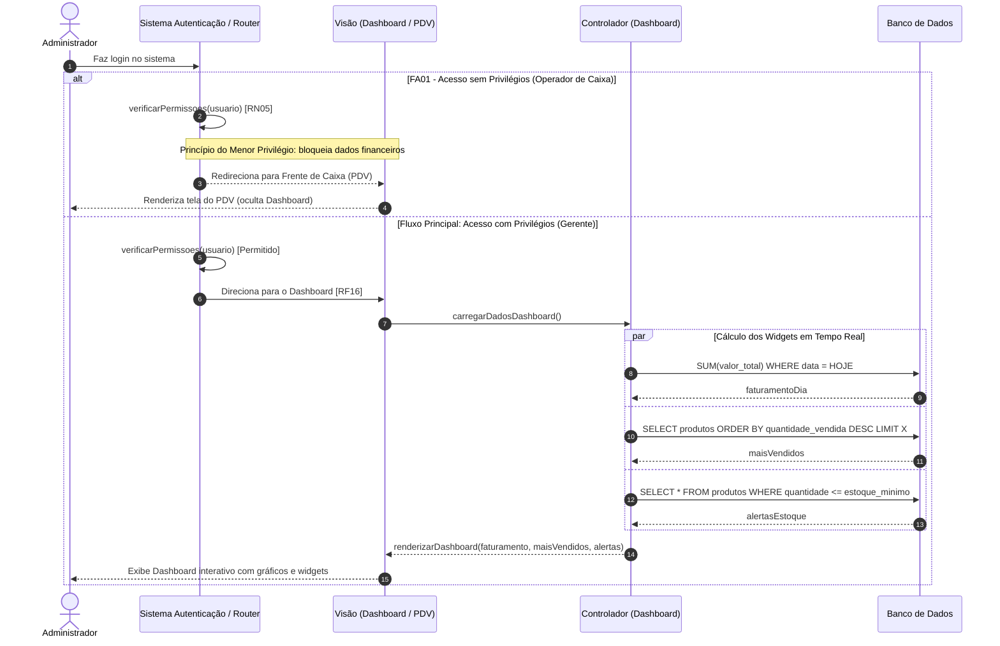

Objetivo: Prover visão rápida da saúde do negócio ao acessar o sistema. Requisitos Relacionados: [RF16], [RN05]

Fluxo Principal:

1. O usuário faz login no sistema.
    
2. O sistema direciona o gerente para o Dashboard [RF16].
    
3. O sistema calcula em tempo real os widgets de: Faturamento do Dia, Produtos Mais Vendidos e Alertas de Estoque Baixo.
    
4. O usuário interage com os gráficos.
    

Fluxos Alternativos:

- FA01 - Acesso sem Privilégios: Um Operador de Caixa faz login. Aplicando o Princípio do Menor Privilégio [RN05], o sistema bloqueia os dados financeiros, oculta o Dashboard e redireciona o operador diretamente para o PDV (Frente de Caixa).
    

