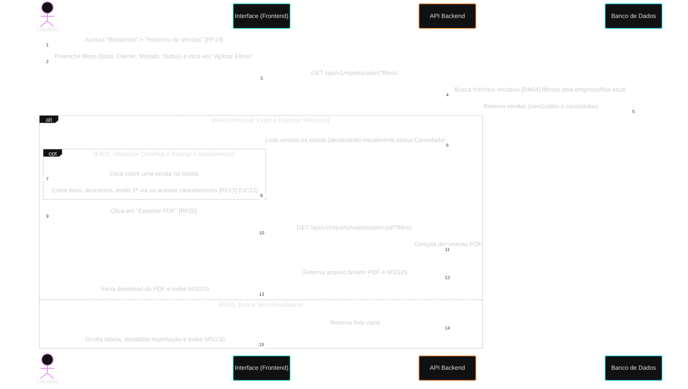

Objetivo: Extrair histórico imutável de vendas (concluídas e canceladas) e conferir faturamento. Requisitos Relacionados: [RF17, RF19, RF20], [RN04] 
Fluxo Principal:

1. O usuário acessa "Relatórios" > "Histórico de Vendas" [RF19].
    
2. Preenche os filtros (Data, Cliente, Método, Status) e clica em "Aplicar Filtros".
    
3. O sistema busca os dados no histórico imutável [RN04], filtrando automaticamente pela empresa/filial atual, e lista na tabela (destacando visualmente vendas com status Cancelada).
    
4. O usuário clica em "Exportar PDF" [RF20].
    
5. O sistema compila o PDF, inicia o download e exibe a mensagem (MSG29).
    

Fluxos Alternativos:

- FA01 - Busca Sem Resultados: Com filtros sem correspondência, o sistema oculta a tabela, desabilita a exportação e exibe a mensagem (MSG30).
    
- FA02 - Visualizar Detalhes e Acionar Cancelamento: O usuário clica sobre a venda na tabela para ver os itens, descontos, emitir 2ª via ou acionar o cancelamento [RF17] (UC12).
    

Mensagens do Sistema (UC13):

- MSG29: "Relatório de vendas gerado e exportado em PDF com sucesso."
    
- MSG30: "Nenhuma venda encontrada para o período selecionado."
    
    
