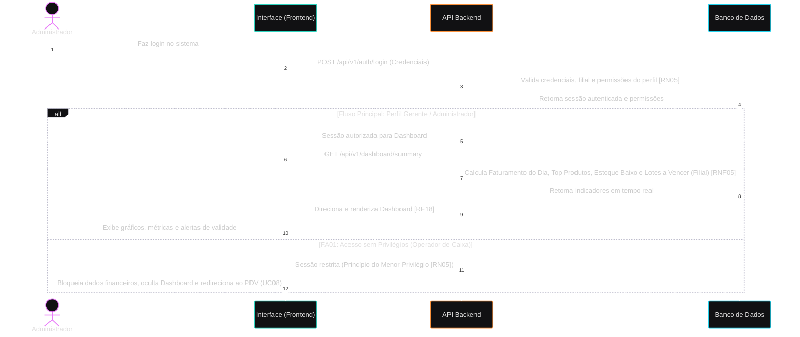

Objetivo: Prover visão rápida da saúde financeira e operacional da filial ao acessar o sistema. Requisitos Relacionados: [RF18], [RN05], [RNF05] 
Fluxo Principal:

1. O gerente/administrador faz login no sistema.
    
2. O sistema direciona o usuário para o Dashboard [RF18].
    
3. O sistema calcula em tempo real os widgets de: Faturamento do Dia, Produtos Mais Vendidos, Alertas de Estoque Baixo e Alertas de Lotes Próximos do Vencimento (exibindo produto, código do lote, saldo restante e dias para vencer), garantindo isolamento pelos dados da filial logada [RNF05].
    
4. O usuário interage com os gráficos e alertas.
    

Fluxos Alternativos:

- FA01 - Acesso sem Privilégios: Um Operador de Caixa faz login. Aplicando o Princípio do Menor Privilégio [RN05] e o controle de permissões por perfil de acesso, o sistema bloqueia os dados financeiros, oculta o Dashboard e redireciona o operador diretamente para o PDV (UC08).
    
    

