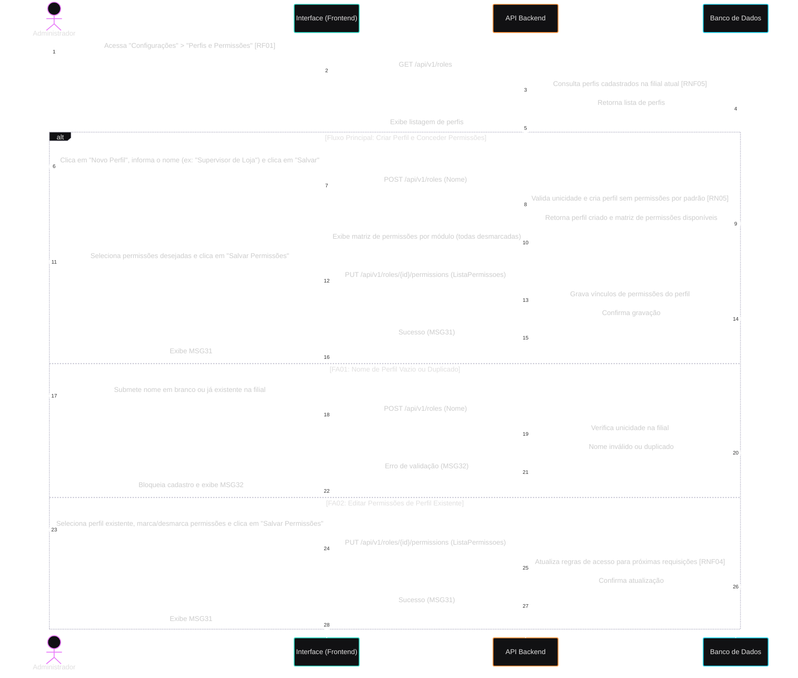

Objetivo: Criar perfis de acesso (cargos) e parametrizar suas permissões por módulo e funcionalidade, aplicando o Princípio do Menor Privilégio.

Requisitos Relacionados: [RF01], [RN05], [RNF04, RNF05]

Fluxo Principal (Criar Perfil e Conceder Permissões):

1. O administrador acessa o menu lateral e clica em "Configurações" > "Perfis e Permissões" [RF01].
    
2. O sistema exibe a lista de perfis cadastrados na empresa/filial atual [RNF05] e o administrador clica em "Novo Perfil".
    
3. O administrador informa o nome do perfil (ex: "Supervisor de Loja") e clica em "Salvar".
    
4. O sistema cria o perfil sem nenhuma permissão marcada por padrão, aplicando o Princípio do Menor Privilégio [RN05], e exibe a matriz de permissões disponíveis por módulo.
    
5. O administrador seleciona as permissões desejadas (ex: "Cancelar Venda", "Registrar Sangria", "Visualizar Dashboard") e clica em "Salvar Permissões".
    
6. O sistema grava os vínculos no banco de dados e exibe a mensagem (MSG31).
    

Fluxos Alternativos:

- FA01 - Nome de Perfil Vazio ou Duplicado: No passo 3, caso o nome do perfil esteja em branco ou já exista na filial, o sistema bloqueia o cadastro e exibe a mensagem (MSG32).
    
- FA02 - Editar Permissões de Perfil Existente: O administrador seleciona um perfil já cadastrado, marca ou desmarca permissões na matriz e clica em "Salvar Permissões". O sistema atualiza as regras de acesso para as próximas requisições [RNF04] e exibe a mensagem (MSG31).
    

Mensagens do Sistema (UC15):

MSG31: "Permissões do perfil salvas com sucesso!"

MSG32: "Informe um nome de perfil válido e não duplicado."

