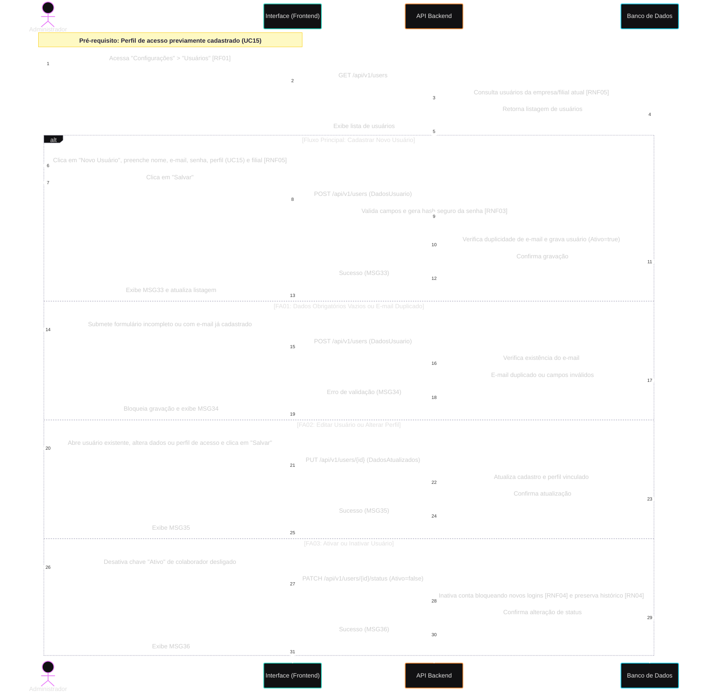

Objetivo: Cadastrar colaboradores no sistema, vincular seus respectivos perfis de acesso e gerenciar o status de ativação de suas contas.

Requisitos Relacionados: [RF01], [RN04, RN05], [RNF03, RNF04, RNF05]

Pré-requisito: Existência de pelo menos um perfil de acesso previamente cadastrado (UC15).

Fluxo Principal (Cadastrar Novo Usuário):

1. O administrador acessa o menu lateral e clica em "Configurações" > "Usuários" [RF01].
    
2. O sistema exibe a listagem de usuários da empresa/filial atual [RNF05] e o administrador clica em "Novo Usuário".
    
3. O administrador preenche nome completo, e-mail de acesso, senha inicial e seleciona o "Perfil de Acesso" (cadastrado no UC15) e a filial de vínculo [RNF05].
    
4. O administrador clica em "Salvar".
    
5. O sistema valida os dados, armazena a senha criptografada (hash seguro) [RNF03], registra o usuário como ativo e exibe a mensagem (MSG33).
    

Fluxos Alternativos:

- FA01 - Dados Obrigatórios Vazios ou E-mail Duplicado: No passo 4, caso algum campo obrigatório esteja em branco ou o e-mail já esteja cadastrado, o sistema bloqueia a gravação e exibe a mensagem (MSG34).
    
- FA02 - Editar Usuário ou Alterar Perfil: O administrador abre o cadastro de um usuário existente, altera seus dados ou troca seu perfil de acesso e clica em "Salvar". O sistema atualiza o registro e exibe a mensagem (MSG35).
    
- FA03 - Ativar ou Inativar Usuário: O administrador desativa a chave "Ativo" de um colaborador desligado. O sistema bloqueia imediatamente novos logins desse usuário [RNF04], preservando seu registro histórico nas vendas e movimentações de caixa já realizadas [RN04], e exibe a mensagem (MSG36).
    

Mensagens do Sistema (UC16):

MSG33: "Usuário cadastrado com sucesso!"

MSG34: "Preencha todos os campos obrigatórios ou informe um e-mail não cadastrado."

MSG35: "Dados do usuário atualizados com sucesso!"

MSG36: "Status do usuário atualizado com sucesso."

