# Política de privacidade e proteção de dados do RelSys

Versão: `1.0` · Status: proposta alinhada à LGPD (Lei nº 13.709/2018) e aos requisitos `RNF03`, `Escopo.md:5`, `Requisitos.md:14,86`.

> Este documento é uma proposta de política operacional para o produto. A redação final e os prazos de retenção devem ser validados pelo jurídico da empresa controladora.

## 1. Papéis e abrangência

| Papel | Definição |
|---|---|
| Controlador | A empresa/filial cadastrada no `COMPANY`, responsável pelas decisões sobre coleta e uso dos dados de clientes, fornecedores e colaboradores |
| Operador | A RelSys Corporation ou o provedor de infraestrutura contratado, quando atuar no tratamento em nome do controlador |
| Titular | Cliente, fornecedor (quando pessoa física) ou usuário do sistema |
| Encarregado/DPO | Responsável designado pelo controlador para receber solicitações de titulares |

A política aplica-se a dados coletados no MVP: cadastros, estoque, vendas, caixa, relatórios, autenticação e auditoria. Estão fora de escopo emissão fiscal SEFAZ e conciliação bancária (`Escopo.md:14-18`).

## 2. Dados tratados

| Categoria | Dados | Finalidade | Base legal LGPD |
|---|---|---|---|
| Conta de usuário | Nome, e-mail de acesso, senha em hash, perfil, filial de vínculo | Autenticar, autorizar e rastrear operações | Art. 7º, II e V |
| Cliente PF | Nome, CPF, e-mail | Identificar cliente e emitir comprovante/resumo | Art. 7º, II |
| Cliente PJ | Razão social, nome fantasia, CNPJ, e-mail | Identificar cliente corporativo | Art. 7º, II |
| Consumidor final | Identificador `D`, sem documento | Viabilizar venda avulsa por minimização | Art. 7º, II e V |
| Fornecedor | Nome/razão social, CPF/CNPJ, isenção de desconto | Gestão de compras e regras comerciais | Art. 7º, II e V |
| Venda | Itens, preços snapshot, descontos, método de pagamento, status, responsável, motivo de cancelamento | Histórico imutável, CMV, relatórios e estorno | Art. 7º, II, III e V |
| Caixa | Fundo de troco, sangrias, reforços, estornos, valores contados e divergências | Conciliação operacional (RN06) | Art. 7º, II, III e V |
| Auditoria | Usuário, ação, entidade,IP, `traceId`, timestamp | Segurança, rastreabilidade e investigação | Art. 7º, III e V |
| Logs técnicos | IP, user agent, endpoint, código de erro, tempo de resposta | Disponibilidade e diagnóstico | Art. 7º, V |

O RelSys **não solicita** dados sensíveis do Art. 5º, II da LGPD (raça, religião, saúde, biometria, orientação sexual etc.) e não os utiliza para decisões automatizadas ou publicidade.

## 3. Princípios aplicados

1. **Minimização:** cliente é opcional na venda (`RF12`, UC11); quando não informado, usa-se consumidor final sem CPF/CNPJ.
2. **Finalidade:** dados são usados apenas para operação comercial, financeira, estoque, segurança e cumprimento legal.
3. **Imutabilidade controlada:** histórico de vendas não é apagado por alteração cadastral (RN04); anonimização preserva o registro comercial.
4. **Isolamento:** dados são filtrados pela empresa/filial ativa (RNF05).
5. **Segurança por padrão:** acesso restrito por RBAC e negação por padrão (RN05); ver `Seguranca/modelo-seguranca.md`.
6. **Transparência:** campos de cadastro e finalidades são informados no momento da coleta.

## 4. Fluxo de anonimização

```mermaid-next
%%{init: {'theme': 'redux-dark-color'}}%%
flowchart LR
    Request["Titular solicita anonimização"] --> Dpo["DPO valida identidade e base legal"]
    Dpo --> Api["PATCH /clients/{id}/anonymize com motivo"]
    Api --> Perm["Permissão CLIENT:ANONYMIZE"]
    Perm --> Mask["Substitui nome, e-mail, CPF/CNPJ<br/>por valores irreversíveis"]
    Mask --> Status["Status ANONYMIZED e anonymizedAt"]
    Status --> History["Mantém vendas antigas e lotes por ID"]
    History --> Audit["Registra AUDIT_LOG sem expor documento original"]
    Audit --> Done["Confirmação ao titular"]
```

Regras:

- Anonimização é **irreversível**; pseudonimização não é considerada anonimização e continua sendo dado pessoal.
- O identificador interno do cliente é preservado para não quebrar chaves estrangeiras e relatórios.
- Snapshots em `PRODUCT_SALE` e os registros de `SALE` permanecem íntegros (RN04).
- A solicitação, o responsável e o motivo são registrados em auditoria.
- Se houver obrigação fiscal de manter o documento original, aplica-se bloqueio de acesso em vez de anonimização, com registro da decisão.

## 5. Retenção proposta

| Dado | Retenção | Observação |
|---|---|---|
| Conta de usuário | Durante o vínculo + 5 anos após inativação | Preserva histórico operacional |
| Dados de cliente/fornecedor | Até anonimização ou 5 anos após último movimento | Ajustar conforme obrigação fiscal |
| Vendas e títulos | 5 anos, sem exclusão física | RN04 + legislação contábil/fiscal aplicável |
| Sessões de caixa e divergências | 5 anos | RN06 |
| `AUDIT_LOG` | 1 ano para ações críticas; 6 meses para login | Proposta; validar com jurídico |
| Logs técnicos | 90 dias | Sem senhas, tokens ou documentos completos |
| Backups | 35 dias com criptografia | Restauração deve aplicar a mesma política de retenção |
| Dado anonimizado | Indefinido | Deixou de ser dado pessoal se a anonimização for irreversível |

## 6. Direitos do titular

O titular pode solicitar ao controlador:

- confirmação da existência de tratamento;
- acesso aos dados;
- correção de dados incompletos, inexatos ou desatualizados;
- anonimização, bloqueio ou eliminação de dados desnecessários ou tratados em desconformidade;
- portabilidade, quando aplicável;
- informações sobre compartilhamento;
- revisão de decisões automatizadas, se houver.

Canal: encaminhar solicitação ao encarregado designado pelo controlador. O prazo de resposta é de até 15 dias, conforme a LGPD, prorrogável na forma da lei. A identidade do solicitante deve ser verificada antes de qualquer ampliação de acesso.

## 7. Compartilhamento e transferência

| Situação | Regra |
|---|---|
| Provedores de hospedagem/banco | Podem atuar como operadores, com contrato e obrigações de segurança |
| Impressoras locais | Recebem apenas o necessário para cupom/etiqueta; não armazenam dados |
| SEFAZ | Fora de escopo; nenhum envio de NF-e/NFC-e no MVP |
| Terceiros para marketing | Não permitido |
| Autoridades | Somente mediante obrigação legal, com registro e avaliação de escopo |
| Transferência internacional | Não prevista; se ocorrer, exigir base legal e cláusulas contratuais adequadas |

## 8. Medidas técnicas

- TLS em trânsito e criptografia/tokenização para CPF, CNPJ e segredos em repouso.
- Senha armazenada apenas como hash com salt; tokens de refresh em cookie `HttpOnly`, `Secure` e `SameSite`.
- Tokens de acesso em memória no frontend; nunca em `localStorage`.
- Máscara de documento em listagens e logs.
- RBAC, filtro por empresa e auditoria conforme `Seguranca/modelo-seguranca.md`.
- Incidente com risco ao titular: acionar plano de resposta, conter, investigar e comunicar controlador, titular e ANPD quando aplicável.

## 9. Responsabilidades

| Área | Responsabilidade |
|---|---|
| Controlador | Definir finalidades, bases legais, retenção e responder titulares |
| DPO/encarregado | Receber solicitações, orientar e registrar tratamentos |
| Administrador do RelSys | Gerir usuários/permissões e garantir uso mínimo de dados |
| Time de TI | Aplicar criptografia, backup, monitoramento e controle de acesso |
| Desenvolvedores | Não logar dados sensíveis e respeitar o contrato de API |

## 10. Pendências

1. Validar prazos de retenção com o jurídico e com a contabilidade.
2. Nomear o encarregado e publicar o canal de solicitações.
3. Decidir entre anonimização e bloqueio para clientes com obrigação fiscal pendente.
4. Formalizar contratos com operadores de infraestrutura.
5. Implementar `PATCH /clients/{id}/anonymize` e `AUDIT_LOG` antes da entrada em produção.
