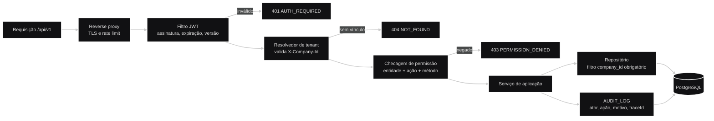

# Modelo de segurança do RelSys

## 1. Princípios

| Princípio | Aplicação no RelSys | Origem |
|---|---|---|
| Menor privilégio | Perfil recém-criado nasce sem permissão; acesso só após concessão explícita | RN05 (`Arquitetura/Requisitos.md:75`) |
| Validação a cada operação | Sessão e permissão verificadas no servidor, não apenas no menu | RNF04 (`Arquitetura/Requisitos.md:88`) |
| Isolamento por empresa | Cliente, produto, estoque, venda, caixa e relatórios filtrados pela empresa ativa | RNF05 (`Arquitetura/Requisitos.md:90`) |
| Imutabilidade e rastreabilidade | Venda cancelada nunca é excluída; responsável e motivo são preservados | RN04 (`Arquitetura/Requisitos.md:73`) |
| Privacidade por projeto | Venda avulsa sem cliente; anonimização preservando histórico | RNF03 (`Arquitetura/Requisitos.md:86`) |
| Negação por padrão | Qualquer recurso sem regra explícita é negado | RN05 + lacuna A13 da análise |

## 2. Fluxo de autorização



## 3. Identidade e autenticação

| Controle | Definição recomendada | Situação atual |
|---|---|---|
| Identificador de login | E-mail de acesso | UC16 usa e-mail; DER usa `USERS.NAME` como UK (lacuna A12) |
| Senha | Hash Argon2id ou bcrypt com salt único; nunca plaintext | UC16 exige “hash seguro”; DER traz `PASSWORD` sem detalhe |
| Access token | JWT assinado, validade curta (15 min sugeridos) | Proposto; não documentado |
| Refresh token | Token opaco rotacionado, 8 h sugeridas, revogável | Proposto; não documentado |
| Inativação de usuário | Bloqueio imediato de novos logins **e revogação de sessões ativas** | UC16 bloqueia novos logins; sessões ativas não especificadas |
| Bloqueio por tentativas | 5 falhas em 10 min → bloqueio temporário e alerta | Proposto; ausente nos UCs |
| MFA | Obrigatório sugerido para Administrador e ações sensíveis | Proposto; ausente nos UCs |
| Troca de senha | Exigir senha atual, nova senha e revogação dos refresh tokens | Proposto; ausente nos UCs |
| Transporte | TLS 1.2+ em toda comunicação | RNF03 (`Requisitos.md:86`) |

## 4. Modelo de autorização

A modelagem atual (`PERMISSIONS_ENTITIES` + `METHOD_NAME`) cobre apenas `GET`, `GET_ID`, `POST` e `PUT` (`Arquitetura/Tabelas/DER-auth.md:64`), mas os UCs usam `PATCH` e ações críticas semânticas (`Arquitetura/Requisitos.md:9`). A forma recomendada é:

```text
Permissão = entidade + ação + método HTTP + nível de sensibilidade
Exemplo: SALE + CANCEL + POST + CRITICAL
```

### 4.1 Matriz de perfis

| Perfil | Permissões típicas | Não permitido |
|---|---|---|
| Administrador | Tudo, inclusive usuários, perfis, anonimização, exportação e configuração | — |
| Gerente | Dashboard, relatórios, cancelamento, sangria/reforço, consulta ampla | Gerenciar usuários/permissões e senhas de terceiros |
| Supervisor (implícito nos UCs) | Aprovar cancelamento, sangria e reforço; consultar vendas | Criar perfis, alterar parâmetros globais |
| Operador de Caixa | Abrir/fechar caixa, vender, emitir comprovante, consultar produtos | Dashboard financeiro, gerenciar usuários, cancelar sem delegação |
| Assistente Administrativo | Clientes, fornecedores, produtos, recebimento e etiquetas | Vender, sangrar caixa, ver dashboard financeiro |


### 4.2 Ações sensíveis

| Ação | Perfil mínimo | Controle adicional |
|---|---|---|
| Aplicar desconto | `SALE:VALIDATE_DISCOUNT` | Validação RN01 no servidor; MSG24 se isento |
| Cancelar venda | `SALE:CANCEL` ou aprovação de supervisor | Motivo obrigatório, responsável, estorno atômico e auditoria |
| Sangria/reforço | `CASH_MOVEMENT:POST` | Motivo obrigatório; aprovação para valores altos |
| Anonimizar cliente | `CLIENT:ANONYMIZE` | Registro de solicitação, irreversibilidade e retenção do histórico |
| Exportar relatório | `REPORT:EXPORT` | Filtro por empresa no servidor e log de exportação |
| Alterar permissões | `ROLE:PERMISSIONS` | Log com valores anterior/posterior; efeito na próxima requisição |
| Inativar usuário | `USER:STATUS` | Revogação imediata de sessões |

## 5. Isolamento multiempresa

1. A empresa ativa vem da sessão; `X-Company-Id` apenas seleciona entre vínculos autorizados.
2. Todo repositório acrescenta `WHERE company_id = :activeCompany`.
3. Chaves únicas devem ser compostas: `(company_id, barcode)`, `(company_id, email)`, `(company_id, cnpj)` etc. (lacuna A05).
4. Recurso de outra empresa retorna `404`/`409 TENANT_MISMATCH` com a mesma mensagem externa.
5. Um usuário pode pertencer a várias empresas (`USERS_COMPANY`).
6. Relatórios, dashboard e exportação PDF herdam o filtro.

## 6. Auditoria

Tabela proposta: `AUDIT_LOG`.

| Coluna | Finalidade |
|---|---|
| `ID`, `COMPANY_ID` | Identificação e tenant |
| `ACTOR_ID`, `ACTOR_ROLE_ID` | Responsável pela ação |
| `ENTITY`, `ENTITY_ID` | Alvo da ação |
| `ACTION` | `CREATE`, `UPDATE`, `CANCEL`, `ANONYMIZE`, `LOGIN`, `EXPORT` etc. |
| `BEFORE_JSON`, `AFTER_JSON` | Snapshot com campos sensíveis mascarados |
| `REASON` | Motivo obrigatório para ações críticas |
| `IP`, `USER_AGENT`, `TRACE_ID` | Correlação com requisição e logs |
| `CREATED_AT` | Ordenação temporal e retenção |

Regras:

- Cancelamento de venda grava `SALE_ID`, motivo, operador Original e operador que cancelou.
- Exportação de relatório registra filtros usados, sem incluir CPF/CNPJ completos.
- Login/logout/falha de login são auditados sem registrar senha.
- Logs não podem conter `password`, token, CPF/CNPJ completos nem dados de cupom impresso.

## 7. Proteção de dados e segredos

| Dado | Classificação | Controle |
|---|---|---|
| `USERS.PASSWORD` | Secreto | Hash forte com salt; nunca logado, nunca retornado pela API |
| Refresh token | Secreto | Armazenado como hash; rotação e revogação |
| CPF/CNPJ | Pessoal identificável | Criptografia em repouso ou tokenização; exibição mascarada; acesso auditado |
| E-mail | Pessoal identificável | Visível apenas a perfis autorizados; mascarado em logs |
| Vendas e valores financeiros | Confidencial comercial | Isolamento por empresa e RBAC |
| Motivo de cancelamento | Confidencial operacional | Acesso restrito a Gerente/Supervisor/Admin |
| Segredos de infra | Secreto | Vault/variáveis de ambiente; rotação; nunca no Git |

