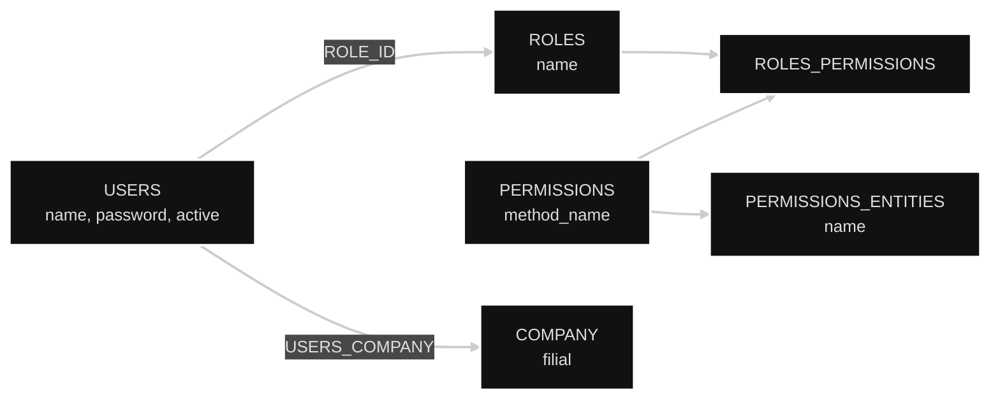
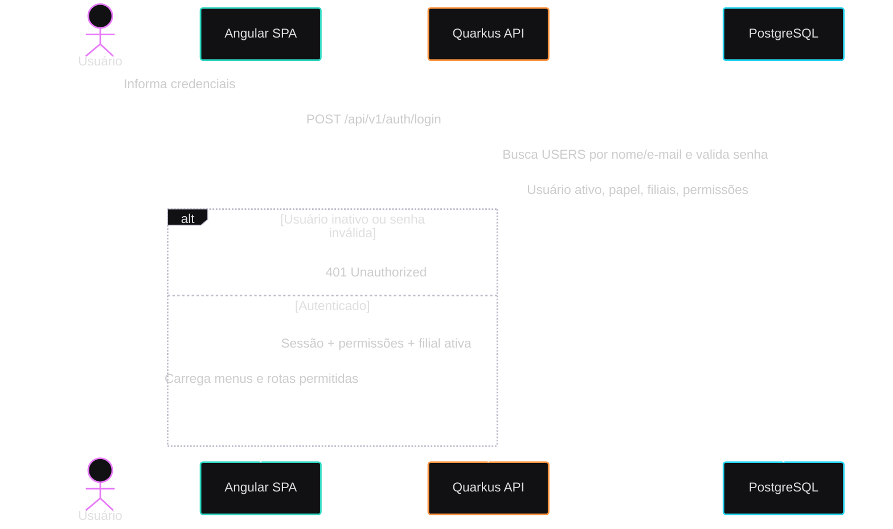

# Modelo de Segurança e Permissões

## 1. Objetivo

Documentar autenticação, autorização, isolamento por filial e menor privilégio para o RelSys, atendendo RF01, RN05, RNF03, RNF04 e RNF05.

## 2. Modelo RBAC

O modelo vigente nos diagramas-base é:

Leitura: um usuário possui **um** papel; um papel possui **várias** permissões; uma permissão aponta para uma entidade e um método. Novo perfil começa sem vínculos em `ROLES_PERMISSIONS` (RN05).

## 3. Fluxo de autenticação

> O endpoint `/auth/login` consta no UC14, mas ainda não possui entidade de sessão no modelo-base — ver R-14 em [[RiscosQuestoesAbertas]].

## 4. Isolamento multi-filial (RNF05)

| Mecanismo | Implementação esperada |
|---|---|
| Vínculo usuário↔filial | `USERS_COMPANY(USER_ID, COMPANY_ID)` |
| Filtro transversal | Toda consulta inclui `COMPANY_ID` da filial ativa da sessão |
| Chaves compostas | Tabelas com `COMPANY_ID` devem usar índice/UK composto quando aplicável |
| catálogos | Revisar R-04: `MOVEMENT_TYPE`, `PERSON_STATUS` e `FINANCIAL_TITLE_STATUS` precisam de decisão de escopo |
| Relatórios e dashboard | Filtro obrigatório por filial em `/reports/sales` e `/dashboard/summary` |

## 5. Matriz de permissões por ator (planejada)

| Funcionalidade | Assistente | Operador | Administrador |
|---|:---:|:---:|:---:|
| Gerenciar clientes/fornecedores/produtos | Sim | Não | Sim |
| Recebimento de produtos | Sim | Não | Sim |
| Abrir/fechar caixa | Não | Sim | Sim |
| Sangria/reforço | Não | Sim¹ | Sim |
| Realizar venda e emitir comprovante | Não | Sim | Sim |
| Cancelar venda | Não | Não² | Sim |
| Relatórios e dashboard | Não | Não | Sim |
| Perfis, usuários e métodos de pagamento | Não | Não | Sim |

¹ Supervisor autorizado pode realizar sangria/reforço conforme UC08 FA01; ator ainda pendente (R-21).
² Depende de permissão explícita concedida ao perfil (RN05).

## 6. Regras de segurança

1. Senha deve ser armazenada como hash seguro, nunca em texto puro (RNF03).
2. Usuário inativo não autentica (UC16 FA03).
3. Toda requisição valida permissão da rota/ação antes da operação (RNF04).
4. Perfil recém-criado não recebe permissões automáticas (RN05).
5. Cancelamento de venda exige permissão específica (UC12 FA03) — depende de R-07.
6. Dados de uma filial não podem ser exibidos para outra (RNF05).

## 7. Lacunas conhecidas

| ID | Lacuna |
|---|---|
| R-07 | `PERMISSIONS.METHOD_NAME` só cobre verbos HTTP; faltam ações como `CANCEL_SALE`, `REGISTER_CASH_WITHDRAWAL`, `VIEW_DASHBOARD` |
| R-10 | `USERS` não tem `EMAIL`; `ROLES` não tem `COMPANY_ID` |
| R-14 | Não há modelo de sessão autenticada/token |
| R-21 | Ator “Supervisor” não formalizado |
| R-15 | Anonimização de clientes sem suporte no modelo |
