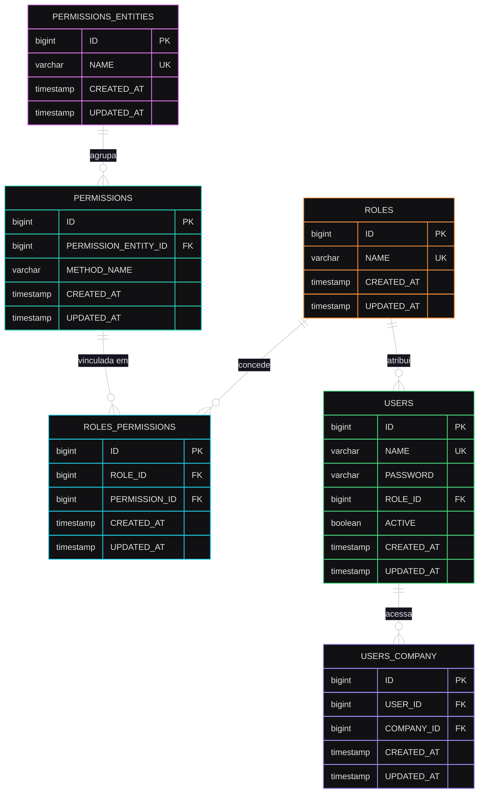

## Tabelas

| Tabela | Descrição |
|---|---|
| `PERMISSIONS_ENTITIES` | Entidades que podem receber permissões (ex.: `PRODUCT`, `SALE`, `ROLE`). |
| `PERMISSIONS` | Permissão = entidade + método HTTP (`METHOD_NAME` ∈ `GET`, `GET_ID`, `POST`, `PUT`). |
| `ROLES` | Papéis de acesso (ex.: `ADMIN`). |
| `ROLES_PERMISSIONS` | Associação N:N entre `ROLES` e `PERMISSIONS` (par `ROLE_ID`, `PERMISSION_ID` único). |
| `USERS` | Usuário do sistema; pertence a um `ROLE`. |
| `USERS_COMPANY` | Associação N:N entre `USERS` e `SYSTEM.COMPANY` (par `USER_ID`, `COMPANY_ID` único). |

## Relacionamentos internos

| Origem | Cardinalidade | Destino | Coluna(s) |
|---|---|---|---|
| `PERMISSIONS_ENTITIES` | 1 : 0..N | `PERMISSIONS` | `PERMISSION_ENTITY_ID` |
| `ROLES` | 1 : 0..N | `ROLES_PERMISSIONS` | `ROLE_ID` |
| `PERMISSIONS` | 1 : 0..N | `ROLES_PERMISSIONS` | `PERMISSION_ID` |
| `ROLES` | 1 : 0..N | `USERS` | `ROLE_ID` |
| `USERS` | 1 : 0..N | `USERS_COMPANY` | `USER_ID` |

## Referências externas

| Coluna | Refere a |
|---|---|
| `USERS_COMPANY.COMPANY_ID` | `SYSTEM.COMPANY.ID` |
