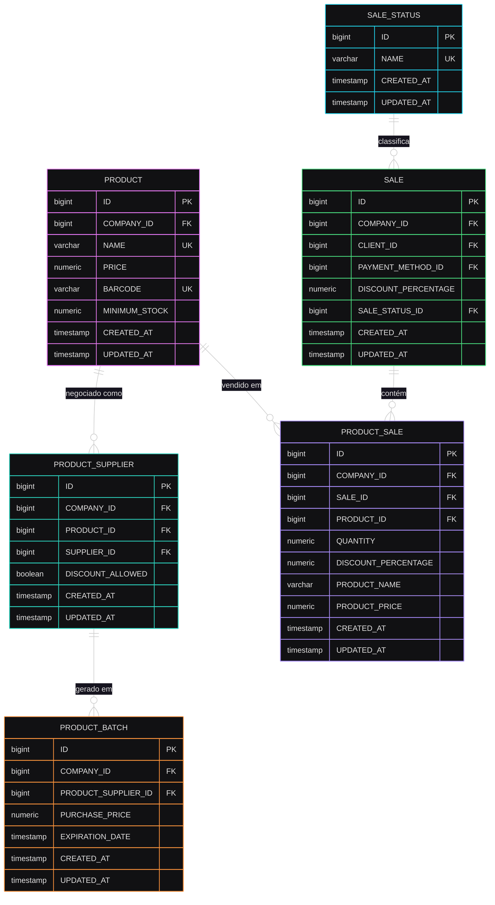

## Tabelas

| Tabela | Descrição |
|---|---|
| `PRODUCT` | Produto cadastrado para a empresa (`NAME` e `BARCODE` únicos por empresa). |
| `PRODUCT_SUPPLIER` | Associação N:N entre `PRODUCT` e `SUPPLIER` (par `PRODUCT_ID`, `SUPPLIER_ID` único por empresa). |
| `PRODUCT_BATCH` | Lote de compra de um produto de um fornecedor (gera os lotes financeiros/estoque). |
| `SALE_STATUS` | Catálogo de status de venda (`PROCESSED`, `CANCELED`). |
| `SALE` | Venda; `DISCOUNT_PERCENTAGE` entre 0 e 100. |
| `PRODUCT_SALE` | Item de venda (lança denormalizações `PRODUCT_NAME` e `PRODUCT_PRICE` no momento da venda). |

## Relacionamentos internos

| Origem | Cardinalidade | Destino | Coluna(s) |
|---|---|---|---|
| `PRODUCT` | 1 : 0..N | `PRODUCT_SUPPLIER` | `PRODUCT_ID` (+ `COMPANY_ID`) |
| `PRODUCT_SUPPLIER` | 1 : 0..N | `PRODUCT_BATCH` | `PRODUCT_SUPPLIER_ID` (+ `COMPANY_ID`) |
| `SALE_STATUS` | 1 : 0..N | `SALE` | `SALE_STATUS_ID` |
| `SALE` | 1 : 0..N | `PRODUCT_SALE` | `SALE_ID` (+ `COMPANY_ID`) |
| `PRODUCT` | 1 : 0..N | `PRODUCT_SALE` | `PRODUCT_ID` (+ `COMPANY_ID`) |

## Referências externas

> Todas as tabelas com `COMPANY_ID` referenciam `SYSTEM.COMPANY.ID`.

| Coluna | Refere a |
|---|---|
| `PRODUCT_SUPPLIER.SUPPLIER_ID` (+ `COMPANY_ID`) | `CRM.SUPPLIER.ID` |
| `SALE.PAYMENT_METHOD_ID` (+ `COMPANY_ID`) | `FINANCIAL.PAYMENT_METHOD.ID` |
| `SALE.CLIENT_ID` (+ `COMPANY_ID`) | `CRM.CLIENT.ID` |
