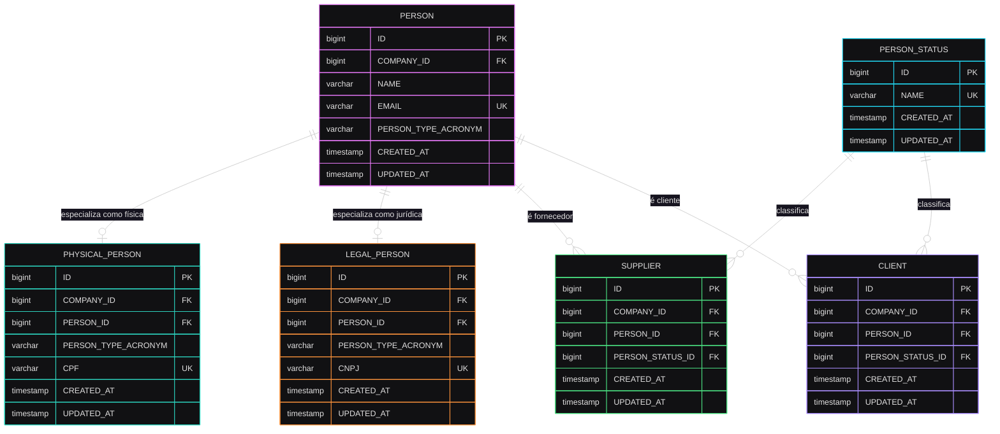

## Tabelas

| Tabela | Descrição |
|---|---|
| `PERSON` | Pessoa base (física, jurídica ou digital). `PERSON_TYPE_ACRONYM` ∈ `P`, `L`, `D`. `EMAIL` único por empresa. |
| `PHYSICAL_PERSON` | Sub-tipo pessoa física; possui `CPF` (11 dígitos, único por empresa). |
| `LEGAL_PERSON` | Sub-tipo pessoa jurídica; possui `CNPJ` (14 dígitos, único por empresa). |
| `PERSON_STATUS` | Catálogo de status (`ACTIVE`, `INACTIVE`). |
| `SUPPLIER` | Pessoa cadastrada como fornecedor (1 pessoa = 1 fornecedor por empresa). |
| `CLIENT` | Pessoa cadastrada como cliente (1 pessoa = 1 cliente por empresa). |

## Relacionamentos internos

> Especialização: `PERSON` tem no máximo **uma** `PHYSICAL_PERSON` **ou** `LEGAL_PERSON` (definido por `PERSON_TYPE_ACRONYM`).

| Origem | Cardinalidade | Destino | Coluna(s) |
|---|---|---|---|
| `PERSON` | 1 : 0..1 | `PHYSICAL_PERSON` | `PERSON_ID` (+ `COMPANY_ID`) |
| `PERSON` | 1 : 0..1 | `LEGAL_PERSON` | `PERSON_ID` (+ `COMPANY_ID`) |
| `PERSON_STATUS` | 1 : 0..N | `SUPPLIER` | `PERSON_STATUS_ID` |
| `PERSON` | 1 : 0..1 | `SUPPLIER` | `PERSON_ID` (+ `COMPANY_ID`) |
| `PERSON_STATUS` | 1 : 0..N | `CLIENT` | `PERSON_STATUS_ID` |
| `PERSON` | 1 : 0..1 | `CLIENT` | `PERSON_ID` (+ `COMPANY_ID`) |

## Referências externas

> Todas as tabelas com `COMPANY_ID` referenciam `SYSTEM.COMPANY.ID`.
