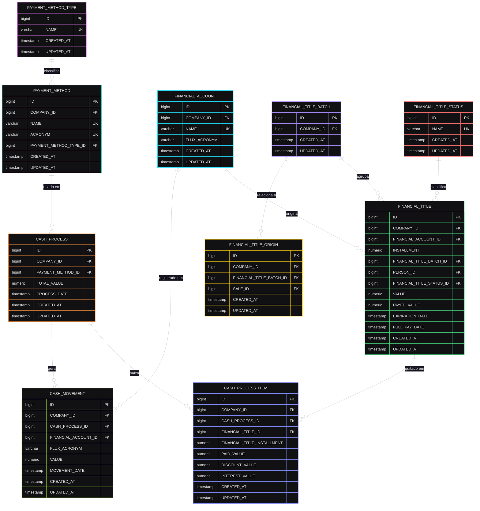

## Tabelas

| Tabela | Descrição |
|---|---|
| `PAYMENT_METHOD_TYPE` | Catálogo de tipos de pagamento (`SINGLE`, `DEFERRED`). |
| `PAYMENT_METHOD` | Método de pagamento da empresa (`NAME` e `ACRONYM` únicos por empresa). |
| `FINANCIAL_ACCOUNT` | Conta financeira (fluxo `R` recebível ou `P` pagável). |
| `FINANCIAL_TITLE_STATUS` | Catálogo de status (`PENDING`, `PARTIAL`, `PAID`, `CANCELED`). |
| `FINANCIAL_TITLE_BATCH` | Lote de títulos gerados em um mesmo evento (ex.: uma venda dividida em parcelas). |
| `FINANCIAL_TITLE` | Título financeiro (parcela); `INSTALLMENT` indica o número da parcela. |
| `FINANCIAL_TITLE_ORIGIN` | Origem do título (ex.: `SALE` do `COMMERCIAL`). |
| `CASH_PROCESS` | Processo de caixa (fechamento/lançamento de pagamentos). |
| `CASH_PROCESS_ITEM` | Baixa de um título dentro do processo de caixa (com desconto/juros). |
| `CASH_MOVEMENT` | Movimentação financeira gerada pelo processo em uma conta (`FLUX_ACRONYM` ∈ `I`, `O`). |

## Relacionamentos internos

| Origem | Cardinalidade | Destino | Coluna(s) |
|---|---|---|---|
| `PAYMENT_METHOD_TYPE` | 1 : 0..N | `PAYMENT_METHOD` | `PAYMENT_METHOD_TYPE_ID` |
| `PAYMENT_METHOD` | 1 : 0..N | `CASH_PROCESS` | `PAYMENT_METHOD_ID` (+ `COMPANY_ID`) |
| `FINANCIAL_ACCOUNT` | 1 : 0..N | `FINANCIAL_TITLE` | `FINANCIAL_ACCOUNT_ID` (+ `COMPANY_ID`) |
| `FINANCIAL_TITLE_BATCH` | 1 : 0..N | `FINANCIAL_TITLE` | `FINANCIAL_TITLE_BATCH_ID` (+ `COMPANY_ID`) |
| `FINANCIAL_TITLE_STATUS` | 1 : 0..N | `FINANCIAL_TITLE` | `FINANCIAL_TITLE_STATUS_ID` |
| `FINANCIAL_TITLE_BATCH` | 1 : 0..N | `FINANCIAL_TITLE_ORIGIN` | `FINANCIAL_TITLE_BATCH_ID` (+ `COMPANY_ID`) |
| `CASH_PROCESS` | 1 : 0..N | `CASH_PROCESS_ITEM` | `CASH_PROCESS_ID` (+ `COMPANY_ID`) |
| `FINANCIAL_TITLE` | 1 : 0..N | `CASH_PROCESS_ITEM` | `FINANCIAL_TITLE_ID` + `FINANCIAL_TITLE_INSTALLMENT` (+ `COMPANY_ID`) |
| `CASH_PROCESS` | 1 : 0..N | `CASH_MOVEMENT` | `CASH_PROCESS_ID` (+ `COMPANY_ID`) |
| `FINANCIAL_ACCOUNT` | 1 : 0..N | `CASH_MOVEMENT` | `FINANCIAL_ACCOUNT_ID` (+ `COMPANY_ID`) |

## Referências externas

> Todas as tabelas com `COMPANY_ID` referenciam `SYSTEM.COMPANY.ID`.

| Coluna | Refere a |
|---|---|
| `FINANCIAL_TITLE.PERSON_ID` (+ `COMPANY_ID`) | `CRM.PERSON.ID` |
| `FINANCIAL_TITLE_ORIGIN.SALE_ID` (+ `COMPANY_ID`) | `COMMERCIAL.SALE.ID` |
