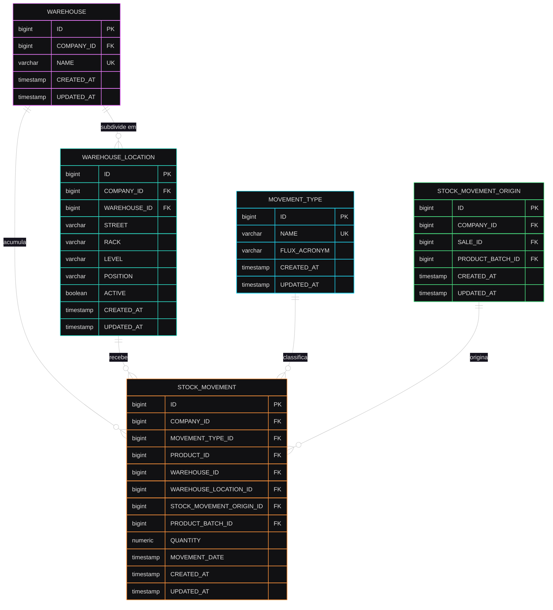

## Tabelas

| Tabela | Descrição |
|---|---|
| `WAREHOUSE` | Armazém da empresa. |
| `WAREHOUSE_LOCATION` | Localização dentro do armazém (`STREET` + `RACK` + `LEVEL` + `POSITION` único por armazém). |
| `MOVEMENT_TYPE` | Catálogo de tipos de movimento (`FLUX_ACRONYM` ∈ `I` entrada, `O` saída, `T` transferência). |
| `STOCK_MOVEMENT_ORIGIN` | Origem do movimento: exatamente **uma** entre `SALE_ID` ou `PRODUCT_BATCH_ID` (regra `CHECK`). |
| `STOCK_MOVEMENT` | Movimento de estoque (entrada/saída/transferência) com produto, localização e lote. |
| `PRODUCT_SALE_BATCH` | Lote de estoque baixado em um item de venda (pontes entre venda e estoque). |

## Relacionamentos internos

| Origem | Cardinalidade | Destino | Coluna(s) |
|---|---|---|---|
| `WAREHOUSE` | 1 : 0..N | `WAREHOUSE_LOCATION` | `WAREHOUSE_ID` (+ `COMPANY_ID`) |
| `WAREHOUSE` | 1 : 0..N | `STOCK_MOVEMENT` | `WAREHOUSE_ID` (+ `COMPANY_ID`) |
| `WAREHOUSE_LOCATION` | 1 : 0..N | `STOCK_MOVEMENT` | `WAREHOUSE_LOCATION_ID` (+ `COMPANY_ID`) |
| `MOVEMENT_TYPE` | 1 : 0..N | `STOCK_MOVEMENT` | `MOVEMENT_TYPE_ID` |
| `STOCK_MOVEMENT_ORIGIN` | 1 : 0..N | `STOCK_MOVEMENT` | `STOCK_MOVEMENT_ORIGIN_ID` (+ `COMPANY_ID`) |

> `STOCK_MOVEMENT` e `PRODUCT_SALE_BATCH` apontam para o mesmo `PRODUCT_BATCH` do `COMMERCIAL`, conectando estoque, vendas e títulos financeiros.

## Referências externas

> Todas as tabelas com `COMPANY_ID` referenciam `SYSTEM.COMPANY.ID`.

| Coluna | Refere a |
|---|---|
| `STOCK_MOVEMENT.PRODUCT_ID` (+ `COMPANY_ID`) | `COMMERCIAL.PRODUCT.ID` |
| `STOCK_MOVEMENT.PRODUCT_BATCH_ID` (+ `COMPANY_ID`) | `COMMERCIAL.PRODUCT_BATCH.ID` |
| `STOCK_MOVEMENT_ORIGIN.SALE_ID` (+ `COMPANY_ID`) | `COMMERCIAL.SALE.ID` |
| `STOCK_MOVEMENT_ORIGIN.PRODUCT_BATCH_ID` (+ `COMPANY_ID`) | `COMMERCIAL.PRODUCT_BATCH.ID` |
| `PRODUCT_SALE_BATCH.PRODUCT_SALE_ID` (+ `COMPANY_ID`) | `COMMERCIAL.PRODUCT_SALE.ID` |
| `PRODUCT_SALE_BATCH.PRODUCT_BATCH_ID` (+ `COMPANY_ID`) | `COMMERCIAL.PRODUCT_BATCH.ID` |
