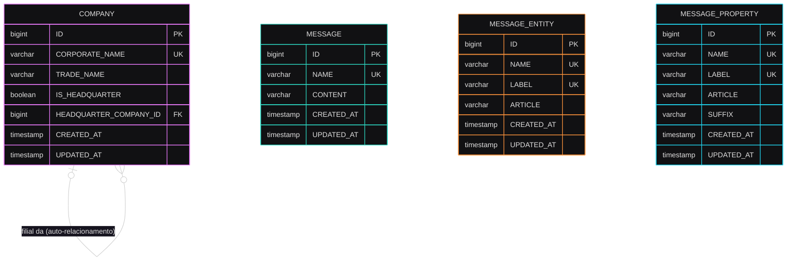

## Tabelas

| Tabela | Descrição |
|---|---|
| `MESSAGE` | Catálogo de mensagens de erro/regra de negócio (`NAME` único). |
| `MESSAGE_ENTITY` | Catálogo de entidades referenciadas nas mensagens (`NAME` e `LABEL` únicos). |
| `MESSAGE_PROPERTY` | Catálogo de propriedades referenciadas nas mensagens (`NAME` e `LABEL` únicos). |
| `COMPANY` | Empresa; `IS_HEADQUARTER` indica matriz. Pode apontar (`HEADQUARTER_COMPANY_ID`) para a empresa matriz. |

## Relacionamentos internos

| Origem | Cardinalidade | Destino | Coluna(s) |
|---|---|---|---|
| `COMPANY` (matriz) | 1 : 0..N | `COMPANY` (filial) | `HEADQUARTER_COMPANY_ID` |

## Referências externas

Nenhuma. Todas as chaves estrangeiras deste schema apontam para tabelas do próprio `SYSTEM`.
